# Features

A complete tour of what PowerDNS-AuthAdmin does, grouped by concern, with module pointers so you
can jump straight into the code that owns each feature.

> **Reading this document.** Each section starts with **what** the feature does, then **where**
> the code lives, then **how** to use / configure it. If you want a quickstart, read the
> [README](../README.md) first.

> **Visual tour.** Every page below is captured in light + dark, desktop + iPhone-framed mobile,
> in [`screenshots/`](../screenshots/README.md). Inline shots in this doc auto-switch theme to
> match your reader; click through for the mobile variant.

---

## 1. Authentication

Operator guides: [OIDC](./05-OIDC.md), [SAML 2.0](./13-SAML.md), [LDAP](./12-LDAP.md),
[Passkeys & security keys](./11-PASSKEYS.md). Every sign-in method ends in the same
`VerifiedIdentity` → `startSession()` path (ADR-0018), so sessions, CSRF, MFA policy and
the audit trail behave identically whichever door the user came through.

### 1.1 Local accounts (email + password)

- **What.** Sign in with email + Argon2id-hashed password. OWASP 2024 parameters. Hashes are
  re-derived (`needsRehash`) on every successful login if the parameter set has been tightened.
- **Where.** `lib/auth/password.ts`, `lib/auth/providers/local.ts`, `app/api/auth/login/route.ts`,
  `app/(auth)/login/`.
- **How.**
  - Bootstrap the first admin via `BOOTSTRAP_ADMIN_EMAIL` + `BOOTSTRAP_ADMIN_PASSWORD` env (see
    `.env.example`). The seed is idempotent - keyed on the email, it ensures that account exists
    and never clobbers an existing one.
  - Add more users from `/admin/users` (gated on `user.create`). The admin can issue a
    one-time temporary password that forces the user to change on first login.
  - Lockout policy is operator-tunable: `login_lockout_threshold` (1–100 attempts) and
    `login_lockout_seconds` (60–86400) on the admin Settings page.
  - The login path is constant-time even when the user doesn't exist - defends against email
    enumeration.

### 1.2 OIDC SSO

- **What.** Generic OIDC (Authorization Code + PKCE) via `openid-client`. Multiple providers
  configurable per install. Discovery happens at sign-in; the AS metadata is cached in-process.
  Auto-detects whether the IdP wants `client_secret_basic` or `client_secret_post`; falls back
  to the other method on `invalid_client` so an IdP whose advertised list disagrees with its
  per-client config still works.
- **Where.** `lib/auth/providers/oidc.ts`, `lib/auth/providers/oidc-probe.ts`,
  `app/api/auth/oidc/[provider]/{initiate,callback}/route.ts`,
  `app/(app)/admin/authentication/` (+ `oidc/[id]/page.tsx`).
- **How.**
  - Add a provider from `/admin/authentication` (gated on `auth.manage`). The
    unified Authentication page lists Local Auth + every configured OIDC, SAML
    and LDAP provider in one table; per-provider edit pages live under
    `/admin/authentication/oidc/<id>` (and `/saml/<id>`, `/ldap/<id>`).
  - The redirect URI to register with the IdP is `${APP_URL}/api/auth/oidc/<slug>/callback`.
  - Slugs are **globally unique across every authentication provider** (OIDC,
    SAML, LDAP) - the `auth_provider_slugs` table enforces this at the DB
    level, so the same slug can't be reused across protocol types.
  - Per-provider toggles:
    - `enabled` - hides the provider from the login page when off.
    - `require_email_verified` - default on; sign-in is blocked unless the IdP attests
      `email_verified: true`. Defends against account-takeover when the same email exists
      locally and the IdP lets users set arbitrary unverified emails. Relax it only for IdPs
      that never emit the claim.
    - `allowed_email_domains` - per-provider override of the env-level allow-list.
  - **Default sign-in method** lives on the unified Authentication page, not
    on individual providers. Pick "Local Auth" or one of the configured
    providers from the dropdown; `/login` auto-redirects on a fresh visit
    (escape hatch: `/login?force-local=1`).
  - Discovery health is operator-pollable via the **Test** button on the providers list AND
    the edit page; the result is cached on the row's `discovery_cache` field.
  - **RP-initiated logout.** When the IdP advertises an `end_session_endpoint`, sign-in
    captures it + the raw id_token on the session row. Logout navigates the browser to
    `<end_session_endpoint>?id_token_hint=…&client_id=…` so the IdP ends its own session and
    renders its signed-out screen. No `post_logout_redirect_uri` is sent - most IdPs require
    it pre-registered and silently strip it otherwise.

<picture>
  <source media="(prefers-color-scheme: dark)" srcset="../screenshots/dark/oidc-providers.png" />
  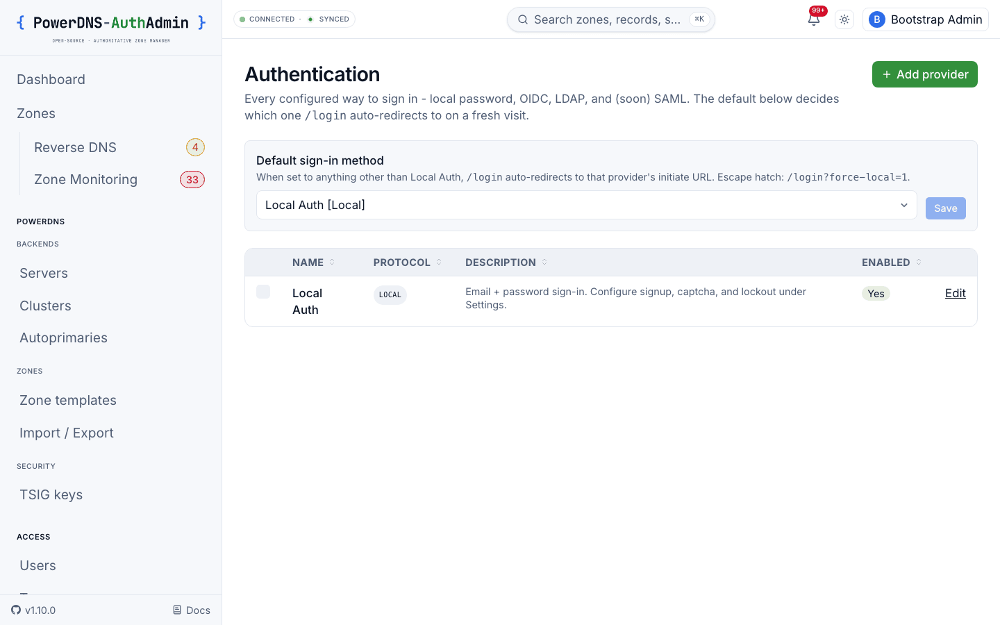
</picture>

### 1.3 Group → role mapping (OIDC / SAML / LDAP)

- **What.** Derive permissions from a user's IdP group claim on every sign-in. The same
  `applyGroupSync` runs for OIDC, SAML and LDAP providers. Since 1.4.0 the result is a
  session-scoped snapshot (`sessions.derived_permissions`) rather than persistent
  `role_assignments` rows, so a user who leaves a group loses the permissions with their
  next sign-in and admin-issued assignments are never touched.
- **Where.** `lib/auth/providers/group-sync.ts` (+ `group-sync-pure.ts`),
  `app/(app)/admin/authentication/oidc/_components/oidc-provider-form.tsx` (the editor; the
  SAML and LDAP forms share the same mapping rows).
- **How.** From a provider's edit page, add rows under **Group → role mappings**: each row pairs
  an IdP group name with a role + scope. Scope syntax is `global`, `team:<slug>`,
  `zone:<fqdn>`, or `server:<slug>`. Mappings whose role/team/server can't be resolved at
  sign-in are logged + audited (`auth.group_sync.mapping_unresolved`, with the provider slug
  in `after.provider`) and skipped - the sign-in still succeeds.

### 1.4 TOTP (multi-factor)

- **What.** Self-service TOTP enrollment for local-password users. Inline SVG QR code rendered
  server-side via `qrcode`; manual setup-key fallback shown alongside. Standard RFC 6238 with
  SHA-1, 30s step, ±1 step skew tolerance, hand-rolled HOTP/Base32 in
  `lib/auth/totp.ts` to avoid an extra dependency.
- **Where.** `lib/auth/totp.ts`, `lib/auth/totp-qr.ts`,
  `app/(app)/profile/_components/totp-section.tsx`, `app/api/profile/mfa/totp/route.ts`,
  `app/api/auth/login/route.ts` (challenge step).
- **How.** From `/profile#mfa`, click **Enable TOTP**, scan the QR with any authenticator app,
  confirm the 6-digit code. Per-role `requires_mfa` enforcement (set on the role edit page)
  redirects non-enrolled users to `/profile?mfa-required=1` until they finish enrolment; either
  TOTP or a passkey / security key (§ 1.8) satisfies it (`lib/auth/mfa-compliance.ts`).
  **SSO-only users** (no local password) see a read-only "Managed by your identity provider"
  panel and are exempt from the `requires_mfa` gate - the IdP is their second-factor authority.

### 1.5 API tokens

- **What.** Per-user `pda_pat_…` tokens with operator-selected permission scopes from the
  user's effective set. Argon2id-hashed at rest, public prefix indexable for lookups.
- **Where.** `lib/auth/tokens.ts`, `lib/db/repositories/api-tokens.ts`,
  `app/(app)/profile/_components/api-tokens-section.tsx`,
  `app/(app)/admin/users/_components/tokens-panel.tsx`,
  `app/api/profile/tokens/`.
- **How.** From `/profile#api-tokens`, **Create token**, pick scopes + optional expiry. The
  plaintext value is shown ONCE and never round-tripped again. Use the token by sending it
  as `Authorization: Bearer pda_pat_…` or `X-API-Key: pda_pat_…`. Admins with `token.read.all`
  see every user's token inventory on the **API tokens** tab of `/admin/users/<id>`. For SSO
  users the token's permissions follow the IdP live - see § 1.13.

### 1.6 Sessions

- **What.** DB-backed sessions (ADR 0007) with encrypted-opaque cookie carrying the row id.
  CSRF via double-submit cookie pair (`csrf_secret` on the row + `csrf` cookie + `x-csrf-token`
  header verified constant-time).
- **Where.** `lib/auth/session.ts`, `lib/auth/csrf.ts`, `lib/db/schema/sessions.ts`.
- **How.** The per-user **Active sessions** panel at `/profile#sessions` lists every browser
  cookie tied to your account with its IP, last-seen timestamp, and a revoke button. Admins
  manage other users' sessions from the **Sessions** tab of `/admin/users/<id>` (gated on
  `user.update`).

### 1.7 Rate limiting

- **What.** Token-bucket per IP for the login + sensitive endpoints. Bounded map size so a
  malicious peer can't OOM the rate-limiter map.
- **Where.** `lib/auth/rate-limit.ts`.
- **How.** Thresholds are compile-time constants in `lib/auth/rate-limit.ts` (`loginLimiter`:
  5 attempts, refill 1/min; `sensitiveLimiter`: 3 attempts, refill 1 per 5 min) - there is no
  env or setting for them. The operator-tunable layer is the per-account lockout
  (`login_lockout_threshold` / `login_lockout_seconds`, § 1.1). Client IP for keys comes
  from the fronting proxy's `X-Forwarded-For`/`X-Real-IP` (`lib/client-ip.ts`); deploy behind a
  proxy that overwrites client-supplied XFF.

### 1.8 Passkeys & security keys (WebAuthn)

- **What.** WebAuthn credentials - platform passkeys (Touch ID, Windows Hello, iCloud Keychain,
  password-manager passkeys) and roaming security keys (YubiKey and friends) - usable two ways:
  **passwordless sign-in** via the "Sign in with passkey" button on `/login`, and as the
  **second factor** after a password (the MFA step offers TOTP or Passkey). Either satisfies a
  role's `requires_mfa`. A user can enrol any number of named credentials and remove them
  individually; an admin can remove a credential from `/admin/users/<id>`, subject to the
  target-privilege ceiling. Ceremonies run through `@simplewebauthn/server`; the RP ID defaults
  to the `APP_URL` hostname and the RP name to the configured site name.
- **Where.** `lib/auth/webauthn/{config,registration,assertion}.ts`,
  `app/api/auth/webauthn/{assertion-options,assertion-verify}/` (sign-in),
  `app/api/profile/mfa/webauthn/{registration-options,registration-verify,[credentialId]}/`
  (enrol / rename / remove), `lib/auth/mfa-compliance.ts` (the `requires_mfa` check). Audit:
  `auth.mfa.webauthn.enrolled|renamed|removed`. Decision record:
  [ADR-0019](./adr/0019-webauthn-passkeys.md).
- **How.** **Profile → Two-factor → Add a passkey.** `WEBAUTHN_*` env knobs (kill-switch, RP
  ID override for apex/sub-domain sharing, user-verification and attestation policy) are in
  [03-CONFIGURATION](./03-CONFIGURATION.md#webauthn--passkeys-optional); the full operator
  guide, including the reverse-proxy notes, is [11-PASSKEYS](./11-PASSKEYS.md).

### 1.9 SAML 2.0 single sign-on

- **What.** A SAML service provider built on `@node-saml/node-saml`. Sign-in builds a signed
  AuthnRequest and redirects via the HTTP-Redirect binding; the IdP POSTs its Response to the
  ACS endpoint, where the signature is verified against the stored IdP certificate (optionally
  requiring a signed Response as well as a signed Assertion), encrypted assertions are
  decrypted with the SP encryption key, and the attributes are mapped to a `VerifiedIdentity`.
  SP metadata is served per provider for one-click IdP registration; single logout is
  supported. Per-provider `allowed_email_domains` and group → role mappings run through the
  shared group sync (§ 1.3). SP private keys are encrypted at rest and never returned by the
  API.
- **Where.** `lib/auth/providers/saml.ts`,
  `app/api/auth/saml/[slug]/{login,acs,metadata,slo}/`,
  `app/(app)/admin/authentication/saml/`, `lib/db/schema/saml-providers.ts`,
  `lib/validators/saml-providers.ts`, the `saml:` provisioning block. Audit:
  `saml.provider.created|updated|deleted`; sign-ins reuse `auth.login.success|failure` with
  `after.method: "saml"` and `after.provider`. Decision record:
  [ADR-0021](./adr/0021-saml-architecture.md).
- **How.** Generate the SP keypair, add the provider under **Admin → Authentication → Add
  provider → SAML**, register `<APP_URL>/api/auth/saml/<slug>/acs` (or the metadata URL) at the
  IdP. Worked examples for Authentik, Keycloak and AD FS in [13-SAML](./13-SAML.md).

### 1.10 LDAP sign-in (Active Directory / OpenLDAP)

- **What.** Direct bind-then-search-then-rebind against an existing directory: bind as a
  service account, find the user with an operator-configured filter (`{{username}}`
  substituted with RFC 4515 escaping), bind again as the user to check the password, then
  resolve groups from a `memberOf`-style attribute or a group search. Strict TLS by default -
  `ldaps://` or StartTLS, plain `ldap://` refused unless `LDAP_ALLOW_INSECURE_PORT_389=true`,
  per-provider CA pin. The bind password is encrypted at rest. The login page shows a
  username + password form per enabled LDAP provider; the route applies the same captcha and
  rate limit as local login. Group → role mappings use the shared sync (§ 1.3).
- **Where.** `lib/auth/providers/ldap.ts` (on `ldapts`),
  `app/api/auth/ldap/[slug]/login/route.ts`, `app/(app)/admin/authentication/ldap/`,
  `lib/db/schema/ldap-providers.ts`, `lib/validators/ldap-providers.ts`, the `ldap:`
  provisioning block. Audit: `ldap.provider.created|updated|deleted`; sign-ins reuse
  `auth.login.success|failure` with `after.method: "ldap"`. Decision record:
  [ADR-0020](./adr/0020-ldap-architecture.md).
- **How.** Add the directory under **Admin → Authentication → Add provider → LDAP**. Worked
  Active Directory and OpenLDAP examples, plus the transport env knobs, in
  [12-LDAP](./12-LDAP.md).

### 1.11 Self-service signup, password reset, email verification and email change

- **What.** Four signed-token flows for local accounts, all built so the response never
  reveals whether an email exists:
  - **Signup** (`SIGNUP_ENABLED`, off by default - `/signup` and `POST /api/auth/signup` are
    404 when off). Creates an **unverified** user holding exactly `SIGNUP_DEFAULT_ROLE`
    (the boot guard refuses an admin-equivalent role), enforces
    `SIGNUP_ALLOWED_EMAIL_DOMAINS`, and blocks login until the address is verified.
  - **Forgot password** (`allow_password_reset` setting; local accounts only).
    `POST /api/auth/forgot-password` always answers 200, mints a `pdr_…` token, and
    `/reset-password` consumes it. Single use without a consumed-tokens table: the token's
    `issuedAt` must be newer than the user's `passwordHashUpdatedAt`. Every session is
    revoked on completion.
  - **Email verification.** `pde_…` tokens; `POST /api/auth/email/send-verification`
    (authenticated) and `POST /api/auth/email/verify` (unauthenticated - the token proves
    ownership, and signup users have no session yet), redeemed on `/verify-email`.
  - **Email change.** From `/profile`, with the current password re-entered; the token is
    bound to `(user, new email)` and confirmed on `/change-email`.
  - **Delivery.** Sent by mail when `SMTP_*` is configured (§ 13). Otherwise the
    verification and email-change links are recorded on their audit row (`after.url`) for an
    operator with `audit.read` to hand over out-of-band. The password-reset link is the
    exception: it is printed once in the server log at warn level and never stored in the
    audit log; the supported alternative is the admin **Reset password** action on
    `/admin/users/<id>` (one-time temporary password, sessions revoked).
- **Where.** `app/api/auth/{signup,forgot-password,reset-password}/`,
  `app/api/auth/email/{send-verification,verify}/`, `app/api/profile/email/change/` (+
  `confirm/`), `app/(auth)/{signup,reset-password,verify-email}/`,
  `app/(app)/change-email/`, `lib/auth/{password-reset-token,email-verification-token}.ts`,
  `lib/auth/signup-policy.ts` (the boot guard), `lib/email/templates.ts`. Audit:
  `auth.signup.rejected`, `auth.password.reset.{requested,completed,invalid}`,
  `auth.email.verify.{sent,completed,invalid}`, `auth.email.change.{requested,completed,invalid}`.
- **How.** Env and the end-to-end signup flow:
  [03-CONFIGURATION → Self-service signup](./03-CONFIGURATION.md#self-service-signup).

### 1.12 Captcha (Cloudflare Turnstile)

- **What.** Optional bot gate on the credential-bearing POSTs: local login, LDAP login, signup,
  forgot-password and change-password. With `TURNSTILE_SECRET_KEY` set the route requires a
  token and verifies it server-side against Cloudflare's `siteverify` (the token is never
  logged); with `TURNSTILE_SITE_KEY` set the forms render the widget. Set both for a
  public-facing login. The verifier reads no env itself, so each route decides when captcha
  is required.
- **Where.** `lib/auth/captcha.ts`, `components/ui/turnstile-widget.tsx`; the Turnstile script
  is allowed by the per-request CSP nonce (`lib/security/csp.ts`). The login routes audit a
  missing or failed token as `auth.login.failure` with
  `after.reason: captcha-missing|captcha-failed`; forgot-password records it as
  `auth.password.reset.invalid` with the same reason.

### 1.13 IdP-derived permissions and API tokens

- **What.** Group-derived permissions live on the session (`sessions.derived_permissions`),
  not in `role_assignments`, so they expire with the session. When an **API token** of an
  OIDC or LDAP user is used, the app re-fetches the user's current groups live - OIDC via the
  encrypted refresh token → userinfo, LDAP via a service-account search - recomputes
  permissions through the same `computeGroupSync` that sign-in uses, and caches the result
  for `IDP_PERMS_CACHE_TTL_SECONDS` (default 60 s). If the live call fails, or for SAML
  (no back-channel), the token falls back to the latest session snapshot for up to
  `TOKEN_IDP_FALLBACK_TTL_SECONDS` (default 24 h); after that it carries admin-issued
  permissions only until the user signs in again. Token scopes still narrow the result.
- **Where.** `lib/auth/providers/idp-perms-recompute.ts`, `lib/auth/providers/idp-perms-cache.ts`,
  `lib/auth/providers/group-sync.ts`, `lib/auth/token-scope-narrowing.ts`. Audit:
  `auth.token.idp_perms_refreshed` (one row per cache miss).

---

## 2. RBAC

### 2.1 Permissions vocabulary

- **What.** A typed list of 54 permission strings spanning every action surface: zones,
  records, SOA, DNSSEC, metadata, TSIG, autoprimaries, templates, users, teams, roles, PDNS
  servers, API tokens, audit, settings, auth providers, system backup.
- **Where.** `lib/rbac/permissions.ts`.
- **How.** Use a permission in a route via `requireUser({ can: "zone.create" })` or in a page
  component via `requireUserForPage({ can: "zone.create" })`. The CASL ability builder
  (`lib/rbac/ability.ts`) enforces it.

### 2.2 System + custom roles

- **What.** Five system roles are seeded (`super-admin`, `team-owner`, `operator`,
  `zone-editor`, `read-only`). Custom roles are operator-defined via `/admin/roles` (gated on
  `role.create`).
- **Where.** `lib/rbac/default-roles.ts`, `lib/db/schema/roles.ts`,
  `app/(app)/admin/roles/`.
- **How.** Each role carries `permissions` (array of strings from the vocab) + `requires_mfa`
  (any user assigned to this role must enrol a second factor - TOTP or a passkey / security
  key - before they can act).

<picture>
  <source media="(prefers-color-scheme: dark)" srcset="../screenshots/dark/roles.png" />
  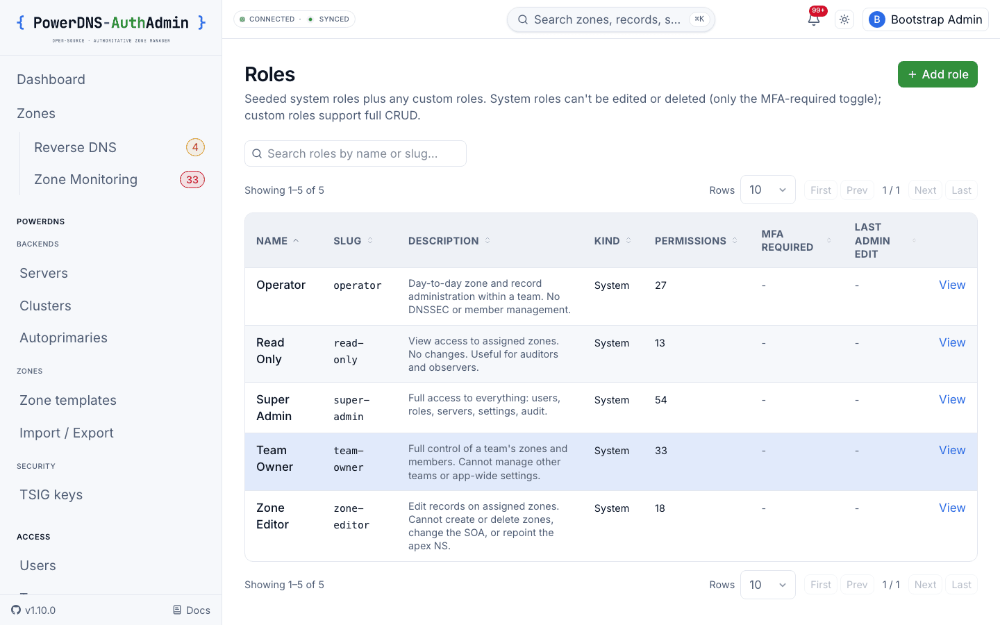
</picture>

### 2.3 Zone-authority permissions

- **What.** The SOA, the apex NS RRset, and the zone-settings object are held apart from
  ordinary record editing, so a role can be given a zone's records without being given the
  zone. `soa.read` / `soa.update` gate the SOA tab; `record.update.apex-ns` is an extra
  requirement on top of `record.*` for writing the apex NS; `zone.settings.read` gates the
  Zone settings tab, whose writes stay on `zone.update`. Missing the read permission removes
  the tab outright rather than greying it out.
- **Where.** `lib/rbac/protected-rrsets.ts` (the classifier both sides share),
  `app/api/admin/pdns/zones/[zoneId]/rrsets/route.ts`,
  `app/api/admin/pdns/zones/[zoneId]/settings/route.ts`,
  `app/(app)/zones/[zoneId]/page.tsx`.
- **How.** The RRset route classifies every change by its normalized name before touching
  PowerDNS, so any client - the SOA panel, the record editor, or a hand-rolled `PATCH` - gets
  the same answer. The permissions work as per-zone grants too. See
  [docs/07-RBAC.md](./07-RBAC.md#splitting-record-editing-from-a-zones-authority).

### 2.4 Scoped assignments

- **What.** Every assignment is `(user, role, scope)` where scope is one of
  `global` / `team:<id>` / `zone:<fqdn>` / `server:<id>`. Zone access is decided by one
  helper, `canActOnZone` (`lib/rbac/zone-permissions.ts`): global roles, per-zone grants and
  zone-scoped roles, so an operator with `record.update` on `zone:example.com.` can edit
  records in every zone named `example.com.` (any backend) but nowhere else; the role's
  non-zone permissions are ignored at zone scope (ADR-0024). Team and server scopes don't open
  zones. Collection views that accept a scoped grant (e.g. the Teams list
  for a team-scoped Team Owner) opt in with `requireUser({ can, anyInstance: true })` and
  filter every row through an instance check; everything else stays global-only.
- **Where.** `lib/rbac/ability.ts`, `lib/rbac/policy.ts`, `lib/rbac/zone-permissions.ts`,
  `lib/rbac/nav-access.ts`, `lib/db/schema/role-assignments.ts`, `lib/db/schema/zone-grants.ts`.
- **How.** Issue assignments from `/admin/users/<id>` (gated on `role.assign`), or let IdP
  group mapping derive them per session (see § 1.3 and § 1.13). Admin-issued assignments and
  IdP-derived permissions never overwrite each other.

### 2.5 Per-zone grants and the Access tab

- **What.** A `zone_grants` row gives a **user or a team** a list of permissions on exactly one
  `(server, zone)` - no role needed. Team grants flow to every member through `team_members`,
  so removing someone from the team revokes the access without touching per-user rows. On a
  multi-primary cluster a grant on one peer authorizes the zone on every peer, so the
  rotating peer picker never produces a spurious 403. Every zone-scoped permission in the
  vocabulary (records, SOA, apex NS, DNSSEC, metadata, zone settings, export) works as a
  grant, including the authority split from § 2.3. The zone's **Access** tab (gated on
  `user.read`, since it reveals emails and team membership) lists every principal with
  access to the zone: roles that carry any zone-scope permission, teams with grants, and
  users with direct grants.
- **Where.** `lib/db/schema/zone-grants.ts`, `lib/db/repositories/zone-grants.ts`,
  `lib/rbac/zone-permissions.ts` (`canActOnZone`, cluster expansion),
  `app/api/admin/users/[id]/zone-grants/` and `app/api/admin/teams/[id]/zone-grants/` (+
  `[grantId]`), `app/(app)/zones/[zoneId]/_components/access-section.tsx`. Audit:
  `zone.grant.create|delete`.
- **How.** From the **Zone grants** tab on `/admin/users/<id>` (`user.update`) or the
  Zone-grants section on `/admin/teams/<id>` (`team.update` on that team), pick a backend,
  type the zone name (any case,
  with or without the trailing dot - the route canonicalizes it) and tick permissions. The
  grant can't exceed what the issuing operator holds themselves.

---

## 3. PowerDNS backends

### 3.1 Multi-backend management

- **What.** The app fronts one or many PDNS Authoritative servers. Three topologies are
  supported and visible side-by-side:
  - **Standalone primary** - single instance, no replication.
  - **Primary + secondaries** - one writable, N read-only mirrors auto-bootstrapped via
    PDNS supermaster + NOTIFY/AXFR.
  - **Multi-primary cluster** - N writable peers sharing a replicated backend (e.g. Galera
    MariaDB). Cluster appears as ONE entry in every selector.
- **Where.** `lib/db/schema/pdns-servers.ts`, `lib/db/schema/pdns-clusters.ts`,
  `lib/db/repositories/{pdns-servers,pdns-clusters,selectable-backends}.ts`,
  `app/(app)/admin/{servers,clusters}/`.

<picture>
  <source media="(prefers-color-scheme: dark)" srcset="../screenshots/dark/powerdns-servers.png" />
  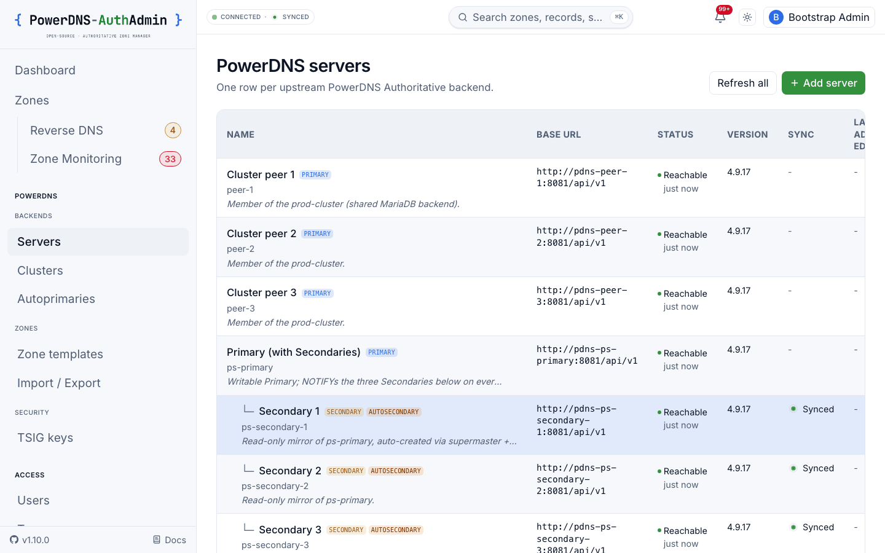
</picture>

### 3.2 Per-cluster peer-selection strategy

- **What.** When operating on a cluster, both reads AND writes route to a peer chosen by the
  cluster's strategy:
  - `round_robin` - spread requests in order.
  - `random` - uniform random.
  - `lowest_latency` - peer with the lowest p50 from the sampler (falls back to round-robin
    until samples exist).
  - `least_load` - peer with the fewest zones from the sampler.
- **Where.** `lib/pdns/cluster-picker.ts`, `lib/pdns/cluster-picker-pure.ts`.
- **How.** Picked from the cluster edit page under **Peer selection strategy**. The column
  in the DB is `write_strategy` (legacy name preserved); the UI label is "Peer selection
  strategy" since it governs both reads and writes.

### 3.3 Read-only backends (write-mode override)

- **What.** A per-backend switch, **Never write to this backend (read-only)**, that removes it
  from every write path while leaving its zones fully browsable. Peer selection skips it, it
  can't be the default backend, and it renders with a `read-only` badge nested under its
  group's write target like a mirror.
- **Why it can't be derived.** Every other role signal in the app is observed from the daemon's
  `/config` (ADR-0014). This one can't be: a public nameserver serving **native** zones fed by
  **database replication** runs with `primary=no, secondary=no` - byte-identical to a standalone
  primary - yet its database user has no write access. PowerDNS exposes no flag for that, so
  without an override the peer picker rotates writes onto it and they fail (#109).
- **Where.** `pdns_servers.write_mode` (`auto` | `read_only`), the `isServerWriteTarget()` /
  `isReadOnlyBackend()` predicates in `lib/pdns/capabilities.ts`, enforced in
  `lib/db/repositories/{pdns-servers,pdns-clusters,selectable-backends}.ts`.
- **How.** Tick the box on the backend's edit page, or set `write_mode: read_only` on a server
  in provisioning YAML. Defaults to `auto`, so existing backends are unaffected.
- **Scope.** The override governs write routing only. AXFR topology derivation still reads the
  daemon's real capabilities, so marking a genuine AXFR primary read-only stops writes to it
  without breaking the secondaries that pull from it. See the 2026-07-22 amendment in
  [ADR-0014](./adr/0014-backend-capability-model.md).

> **Note.** "Use as the default backend" is a _different_ control - it only picks which backend
> serves a request that doesn't name one. It has never constrained peer selection within a group;
> use the read-only switch for that.

### 3.4 Sync probes

- **What.** Two flavours, identical visual shape:
  - **Primary + secondaries.** Compare each secondary's serial against the primary's;
    on-demand rrset diff for any zone that disagrees. Status chip in the zones table.
  - **Cluster.** Compare every peer's serial against the highest-serial peer (used as
    source-of-truth on disagreement, since there's no canonical primary). Same rrset diff
    on demand.
- **Where.** `lib/pdns/sync.ts`, `lib/pdns/cluster-sync.ts`,
  `app/(app)/zones/[zoneId]/_components/sync-section.tsx`.

### 3.5 NOTIFY-on-write + convergence sweep

- **What.** Every code path that creates a zone goes through `createZoneAndNotify()` which
  fires NOTIFY to all secondaries after the create. The provisioning loop additionally runs
  a convergence sweep after all demo zones are created - re-NOTIFYs every Master/Primary
  zone on each touched backend. This catches the docker-compose race where the first zones
  get created before secondaries have registered themselves as supermasters and miss the
  initial NOTIFY.
- **Where.** `lib/pdns/operations.ts`.

### 3.6 PDNS HTTP client

- **What.** Typed thin wrapper over PDNS's HTTP API: zones.list / get / create, rrsets PATCH,
  cryptokeys, metadata, TSIG, autoprimaries, server.info, statistics. Version cache +
  capability flags so feature gates (catalog zones, DNSSEC) reflect the real backend version.
  Retries with backoff, typed error hierarchy (`PdnsError` / `PdnsNotFoundError` /
  `PdnsConflictError`).
- **Where.** `lib/pdns/client.ts`, `lib/pdns/registry.ts`, `lib/pdns/types.ts`,
  `lib/pdns/errors.ts`.

### 3.7 PDNS request log

- **What.** Every HTTP call the app issues to PowerDNS is recorded with timestamp, server,
  operation, method, URL, response status, error (if any), and the correlator `requestId` of
  the audit row that triggered it. Visible at `/admin/requests` with filters for server,
  op, status code, request id, and date range. Each row expands inline to the full request +
  response detail; the `req:` link cross-pivots to / from the matching audit row, so an audit
  failure is one click from the exact PDNS exchange.
- **Where.** `lib/pdns/request-log.ts`, `app/(app)/admin/requests/`,
  `lib/db/repositories/pdns-requests.ts`.

<picture>
  <source media="(prefers-color-scheme: dark)" srcset="../screenshots/dark/pdns-requests.png" />
  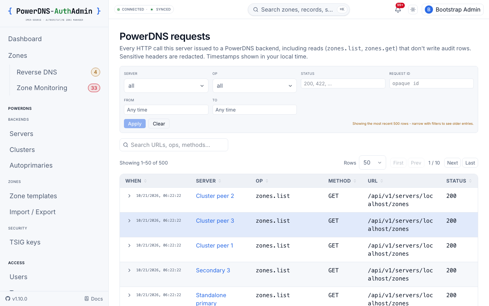
</picture>

### 3.8 Backend health advisories

- **What.** A bell in the top header surfaces active advisories computed every poll cycle:
  unreachable backends, API-key rejections (401/403), replication drift past a threshold, TSIG
  keys missing on a secondary, mirror zones without `masters`, daemon-config drift between
  peers, member zones naming a catalog zone that doesn't exist, and a `default-catalog-zone`
  that is missing or isn't a Producer zone (§ 4.1.2). Zone monitoring findings (§ 20) land in
  the same bell under their own `monitor.` code namespace, visible to users who can read zones. Acknowledged advisories disappear
  automatically when the underlying condition resolves. Same signal feeds the per-row red/warn
  tints on [PowerDNS servers](#31-multi-backend-management) - bell and table never disagree.
- **Where.** `lib/health/evaluator.ts`, `components/domain/health-bell.tsx`,
  `lib/db/repositories/backend-advisories.ts`. Decision record:
  [ADR-0015](./adr/0015-backend-health-advisories.md).

<picture>
  <source media="(prefers-color-scheme: dark)" srcset="../screenshots/dark/backend-health.png" />
  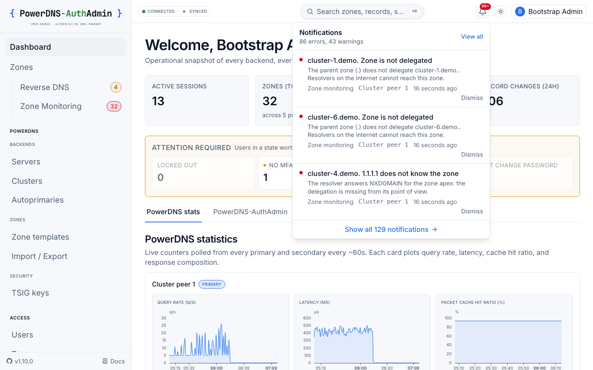
</picture>

### 3.9 SSRF guard

- **What.** Config-time + runtime IP-range checks on PDNS `base_url`. Link-local
  (incl. 169.254.169.254 cloud metadata) is always blocked. Private networks gated by
  `APP_PDNS_ALLOW_PRIVATE_NETWORKS`; `http://` gated by `APP_PDNS_ALLOW_INSECURE_HTTP`.
  At request time the guard re-resolves the host and **pins the validated IP into
  the connection**, so undici reaches the exact address the guard checked (closes
  the DNS-rebinding window).
- **Where.** `lib/pdns/url-safety.ts` (the guard); `lib/pdns/http.ts` (request-time
  re-check + pinned dispatcher).

### 3.10 Observed daemon capabilities

- **What.** Each backend carries a capability snapshot derived from its read-only `/config` on
  every daemon-meta probe: `api`, `primary`, `secondary`, `autosecondary`, the `launch` backends,
  DNSSEC, the configured autoprimary count, and `enable-lua-records`. The active ones render as
  tinted badges wherever a backend is listed; the allowlisted raw settings show verbatim under
  **Daemon settings** on the backend's detail page.
- **Lua records.** `enable-lua-records` (`no` | `yes` | `shared`) is in the snapshot because it
  decides whether the record editor offers the `LUA` type at all. LUA records are executable
  server-side code, so which daemons have it armed has to be visible from the backend list, not
  discoverable only by opening a zone and looking for the type in a dropdown. A daemon-level `no`
  is not a veto: per-zone `ENABLE-LUA-RECORDS` metadata still enables Lua for that one zone.
  PowerDNS 5.1+ also reports `enable-lua-record-updates`, and the snapshot carries it too: with
  it off (the 5.1 default) LUA records are served but can't be created, changed or deleted, so
  the editor stops offering the type.
- **Freshness.** Badges reflect the last probe. After editing `pdns.conf`, re-probe the backend
  (**Admin → PowerDNS servers → Refresh**) - the same gesture that refreshes every other
  capability.
- **Where.** `lib/pdns/capabilities.ts`, `lib/pdns/config-advice.ts`,
  `components/domain/capability-badges.tsx`, `lib/realtime/backend-health.ts`.
  See [ADR-0014](./adr/0014-backend-capability-model.md).

---

## 4. Zones

### 4.1 Amalgamated zones list

- **What.** Every zone across every backend in one list. Per-row "Backend" column. Per-row
  Sync chip: "-" for standalones, "synced/desynced (N)" for primaries with secondaries and
  for clusters.
- **One row per zone identity** - `(horizon, name)`, see § 4.1.1. The same zone reached from a
  primary and its mirrors collapses to one row, resolved to the backend that owns it; anything
  genuinely collapsed is summarized in the "duplicate zones hidden" notice.
- **Where.** `app/(app)/zones/page.tsx`, `app/(app)/zones/_components/zones-table.tsx`,
  `lib/dns/zone-dedupe.ts`.

### 4.1.1 Split-horizon zones (public / internal)

- **What.** A per-zone **horizon** - "this is the internal copy" - set with a toggle at create time
  or later on the zone's **Zone settings** tab. An internal zone lists separately from a public zone
  of the same name, carries an `INTERNAL` badge next to the `CLUSTER` badge, and shows the badge on
  its detail page so it's unambiguous which copy is open before anyone edits a record. A
  Public / Internal filter appears above the list once the fleet has at least one internal zone.
- **Why.** Split-horizon DNS serves the same name differently inside and outside the network,
  usually from two daemons. Before this, the list keyed on the name alone, so the internal copy
  vanished into the "duplicate zones hidden" notice - a deliberate setup reported as an accident of
  replication (#121).
- **How.** App-side classification (PowerDNS cannot tell the two apart), stored sparsely in
  `zone_horizons` and scoped to the backend - to the **cluster** for a cluster zone, so it doesn't
  flicker as peer selection rotates. Unclassified means `public`, so nothing changes for installs
  that don't use it, except under a name reserved for private use (`.internal`, `home.arpa`,
  `.local`, `.test`, `.invalid`, `.localhost`), which defaults to `internal` since it can never be
  delegated on the internet; the create form's switch starts on for such a name, and an explicit
  Public is kept. A mirror of a managed primary inherits that primary's classification. Changes
  are audited as `zone.horizon.update`; deleting a zone drops its classification.
- **Scope.** Presentation and grouping only - it never changes what PowerDNS serves, and it is not
  PDNS 5.0 Views (which splits horizons _within_ one daemon; complementary, not superseded).
- **Where.** `lib/dns/zone-horizon.ts`, `lib/dns/zone-dedupe.ts`,
  `lib/db/{schema,repositories}/zone-horizons.ts`, `components/domain/zone-horizon-badge.tsx`.
  See [ADR-0022](./adr/0022-zone-horizons.md).

<picture>
  <source media="(prefers-color-scheme: dark)" srcset="../screenshots/dark/zones-list.png" />
  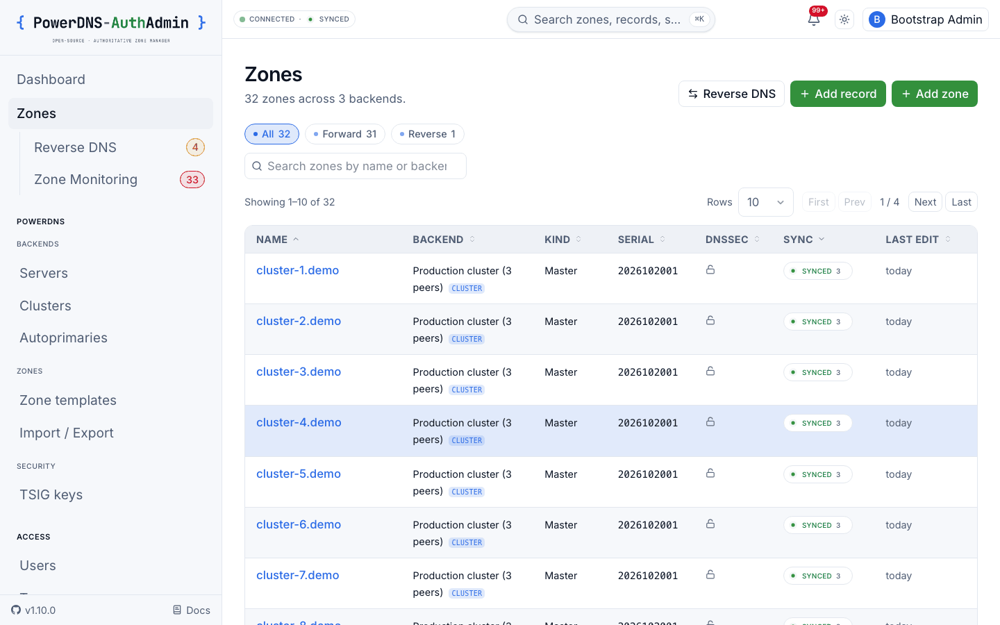
</picture>

### 4.1.2 Catalog zones as system zones

- **What.** Catalog zones (RFC 9432, kinds `Producer` and `Consumer`) are provisioning plumbing,
  not content, so the zones list keeps them out of **Forward / Reverse / All** and lists them on a
  **System** tab (shown only when the fleet has one), with a `catalog · producer|consumer` badge
  and a **Members** column. Their page explains what they are and lists their members; a
  Producer zone's records and DNSSEC are read-only, since PowerDNS generates them.
- **Deleting one.** A Producer zone with members answers `409 catalog-has-members` unless the
  caller passes `?confirmCatalog=<zone>`; the danger zone warns with the member count, asks for
  `yes, delete catalog <zone>` and says that recreating a Producer of the same name restores the
  membership. The audit entry records the kind and member count.
- **Membership.** A zone's **Catalog** is set on its Zone settings tab and in the create form
  (defaulting to the backend's `default-catalog-zone`), from the backend's Producer zones; the
  routes refuse a name that isn't one. The zone header shows `in <catalog>`. Producer zones can be
  created from the app, so a deleted catalog can be restored there.
- **Elsewhere.** Search, the record wizard, Zone Monitoring and Reverse DNS skip system zones; the
  health bell reports a missing catalog and an unresolved `default-catalog-zone` (§ 3.8).
- **Where.** `lib/pdns/zone-kinds.ts` (`isSystemKind`, `catalogRole`), `lib/pdns/catalog.ts`,
  `app/(app)/zones/[zoneId]/_components/catalog-zone-banner.tsx`. Requires PowerDNS 4.7+.

### 4.2 Per-RRset editor with diff-before-apply

- **What.** Edit records inline; the editor batches changes into a single transactional PATCH
  to PDNS with an audit row carrying full before/after JSONB snapshots. Every change runs
  through a **Review changes** modal that previews the BIND-style before/after diff - Save is
  the second click, never the first.
- **Default TTL.** A new record starts with the zone's `X-AUTHADMIN-DEFAULT-TTL` metadata if
  set, else the `default_record_ttl` setting, else 3600. The TTL field says which one applied.
  The per-zone value lives in PowerDNS metadata, so it's set from the zone's Metadata tab
  (`metadata.write`, audited) or seeded on new zones by a template's metadata bag
  (`lib/dns/default-ttl.ts`).
- **Where.** `app/(app)/zones/[zoneId]/_components/editable-record-table.tsx`,
  `app/api/admin/pdns/zones/[zoneId]/rrsets/route.ts`.
- **How.** Per-RR-type validators live in `lib/validators/rr-types/` and run on every change
  pair. Hard-error for shape/range violations; soft-warn for deprecated-but-legal options
  (DS digest-type 1, SSHFP DSA, SVCB unknown SvcParamKey, etc.). Hard errors are gated by an
  explicit **Save anyway** checkbox so an override is always intentional and audited verbatim.

<table>
  <tr>
    <td>
      <picture>
        <source media="(prefers-color-scheme: dark)" srcset="../screenshots/dark/zone-edit.png" />
        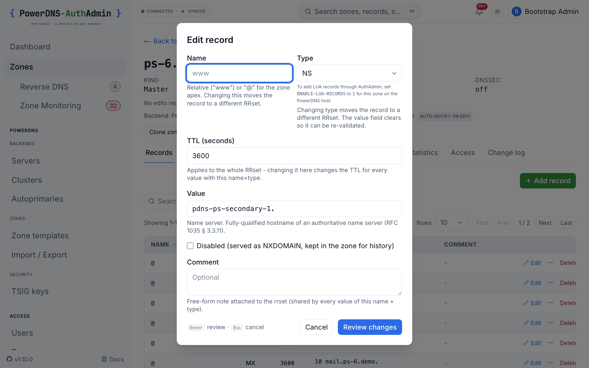
      </picture>
      <br /><sub>Edit dialog - Name / Type / TTL / Value with per-type structured editors.</sub>
    </td>
    <td>
      <picture>
        <source media="(prefers-color-scheme: dark)" srcset="../screenshots/dark/zone-edit-diff.png" />
        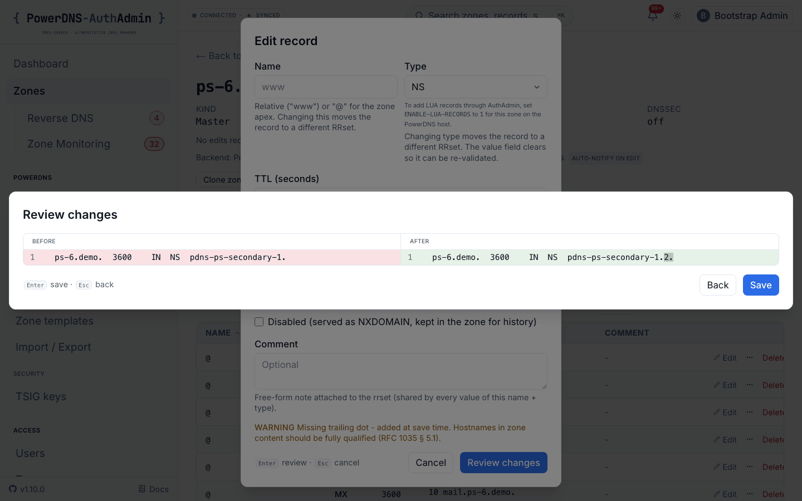
      </picture>
      <br /><sub>Review changes - every save previewed as a before/after diff.</sub>
    </td>
  </tr>
</table>

### 4.3 Zone clone

- **What.** Copy a zone's rrsets into a new zone name on the same backend. The new zone
  ships with the original's records (sans SOA, which PDNS regenerates).
- **Where.** `app/api/admin/pdns/zones/clone/route.ts`, `lib/pdns/clone.ts`.

### 4.4 Zone templates

- **What.** Reusable scaffolding for new zones: NS records, SOA timers, prelude records,
  zone-object settings (`soa_edit`, `soa_edit_api`, `api_rectify`), per-kind metadata bag.
  Templates can be `default_for_primary_slugs` so the create-zone form preselects them when
  the operator picks one of the listed backends.
- **Where.** `lib/db/schema/zone-templates.ts`, `lib/validators/zone-templates.ts`,
  `app/(app)/admin/zone-templates/`.

### 4.5 Zone change log

- **What.** Per-zone feed at `/zones/<id>?tab=history` (the **Change log** tab) rendering every
  audit event with diff (rrset before/after) and one-line summaries for DNSSEC / metadata
  events. Chip colours match the action vocabulary's tone (`lib/audit/action-color.ts`).
  **Show all changes** opens the fleet-wide Change log (§ 9.2) narrowed to this zone, across
  all of its cluster peers.
- **Where.** `app/(app)/zones/[zoneId]/_components/zone-change-log.tsx`.

<picture>
  <source media="(prefers-color-scheme: dark)" srcset="../screenshots/dark/zone-change-history.png" />
  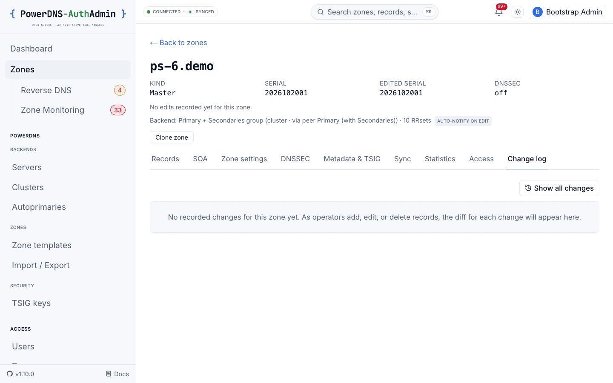
</picture>

### 4.6 Zone import / export (BIND zonefiles)

- **What.** An **Import / Export** hub at `/admin/import-export` (sidebar: PowerDNS → Zones).
  **Import** takes one or many zones in BIND format, pasted or uploaded (2 MiB cap): the
  RFC 1035 parser splits multi-zone input at `$ORIGIN` boundaries, handles `$TTL`, `@`,
  comments and parenthesised multi-line SOAs, refuses `$INCLUDE` (file-traversal vector) and
  skips DNSSEC types (PowerDNS owns those). Each zone becomes one `createZone` call with its
  rrsets pre-populated; failures are reported per zone instead of aborting the batch, and a
  TSIG key can be attached to imported Master zones in the same pass (§ 7). The Lua gate
  (§ 4.7) applies to imported `LUA` records. **Export** picks a backend and any number of
  zones and downloads a single BIND bundle (`$TTL`, `$ORIGIN`, owner names relativised, the
  apex as `@`); the per-zone `GET /api/admin/pdns/zones/[zoneId]/export` returns
  `<zone>.zone` and is what the delete dialog uses to force a backup download first. Output
  round-trips through BIND, NSD and `pdnsutil load-zone`.
- **Where.** `app/(app)/admin/import-export/`, `app/api/admin/pdns/zones/{import,export}/`,
  `app/api/admin/pdns/zones/[zoneId]/export/`, `lib/dns/zonefile-parser.ts`,
  `lib/dns/zonefile-formatter.ts`, `lib/dns/zonefile.ts`. Audit: one `zone.create`
  (`after.source: zonefile-import`) per imported zone, one `zone.export` per exported zone.
- **How.** `zone.read` opens the hub and exports; `zone.create` imports. The `zone.import` /
  `zone.export` permissions in the vocabulary are reserved for finer-grained gating and are
  held by Operator and above.

### 4.7 Lua records

- **What.** The editor offers - and the write path accepts - the PowerDNS `LUA` type only when
  the daemon actually has Lua armed: the global `enable-lua-records` setting **or** the zone's
  `ENABLE-LUA-RECORDS` metadata. The check is re-read live from PowerDNS on every Lua write
  (RRset PATCH and zonefile import alike) and fails closed, so a stale tab or crafted request
  can't land executable records on a server that has Lua off. On PowerDNS 5.1+ the same check
  also requires `enable-lua-record-updates=yes`, which 5.1 needs for any LUA change, deletes
  included; without it the operator gets a message naming that setting rather than PowerDNS's
  bare 422. The content validator checks the
  presentation format (`<query-type> "<snippet>"`, adjacent quoted chunks, `\DDD` escapes,
  the 255-octet boundary) without attempting to parse Lua. Which backends have Lua armed is
  visible from the capability badges (§ 3.10); the DNSSEC tab warns about Lua records on
  replicated signed zones (§ 5).
- **Where.** `lib/pdns/lua-enablement.ts`, `lib/pdns/metadata-policy.ts`,
  `lib/validators/rr-types/lua.ts`.

### 4.8 Automatic PTR maintenance (auto-PTR)

- **What.** Saving or deleting an A/AAAA record also creates, updates or removes the matching
  PTR in a reverse zone hosted on one of the backends (`in-addr.arpa` / `ip6.arpa`, including
  RFC 2317 classless zones such as `0/25.2.0.192.in-addr.arpa.`). Off by default. Switched on
  globally (`auto_ptr` in Settings / provisioning), per zone (`X-AUTHADMIN-AUTO-PTR` = `on` |
  `off` metadata, set from the zone's Metadata tab or seeded by a template), or per save (the
  editor's **Keep the reverse (PTR) record in sync** checkbox; `ptr: true|false` on the RRset
  PATCH and on the MCP record tools). The PTR mirrors the forward record's TTL and `disabled`
  flag.
- **Rules.** The reverse zone is never created: an address with no hosted reverse zone is
  reported as skipped. A PTR that points at a different name is never overwritten unless the
  change carries `ptrTakeover` (the editor offers it in the review step after showing the
  current target), and is never deleted: removing an address only removes a PTR that still
  points at the record's own name. The user needs `record.create`/`record.update`
  (`record.delete` for removals) on the reverse zone, through a global role or a grant on that
  zone; otherwise the PTR is skipped and the current target is not revealed. Forward and
  reverse are two PATCHes: the forward write succeeds first and is never rolled back; every
  PTR outcome is returned per address (`ptr[]` in the response, one line each in the editor's
  toast) and audited as `record.ptr-sync` on the forward RRset, next to the ordinary
  `record.*` rows on the reverse RRset, all sharing the request id. The reverse zone's backend
  is the forward zone's own when it hosts the zone, else a peer of its cluster, else the first
  writable copy; read-only backends and secondary copies are never written.
- **Preview.** The review dialog calls a dry run (`POST …/rrsets/ptr-plan`, same body and
  permissions as the PATCH) and lists what the save will do to reverse DNS before Save.
- **Reverse DNS page (opt-in).** Off by default: set `REVERSE_DNS_ENABLED=true` to turn it
  on. While it is off, the page, its sidebar entry and zones-list button, the PTR chips on
  record tables, the `auto-ptr/report|rectify|links|external-refresh` routes and the
  `reverse_dns_*` MCP tools do not exist (the routes answer 404), so nothing reads the whole
  fleet on its behalf. Auto-PTR on save (above) does not depend on it.
  `/zones/auto-ptr` (button on the zones list; global `record.read`)
  reads every zone once, cached for a minute and shared across users, and lists one row per
  address: **ok**, **missing** (no PTR), **mismatch** (PTR points elsewhere), **ambiguous**
  (several names share the address; pick one), **orphan** (PTR with no forward record) and
  **unhosted**. Rows can be rectified one at a time, as a selection, or all fixable at once
  (`POST /api/admin/pdns/auto-ptr/rectify`), through the same orchestrator with the same
  permission checks and audit rows. Record tables show a chip per A/AAAA row (what its PTR
  says, linked to the reverse zone) and per PTR row (every A/AAAA pointing at the address,
  with a popover when there are several), fed by `GET /api/admin/pdns/auto-ptr/links` and
  filtered by `zone.read` on every zone it names. The sidebar entry **Zones → Reverse DNS**
  carries the number of rows needing attention (missing, mismatch, ambiguous, orphan), counted
  by the zone monitor's last cycle (§ 20.5). An **orphan** row offers **Add** next to its empty
  forward column: it opens the Add record wizard (§ 4.9) with the PTR's target name, the
  address and the record type prefilled, so the missing A/AAAA is two clicks away. Rows that
  report the same finding (orphans pointing at one host, the same mismatch, unhosted addresses
  with the same forward names and upstream answer) fold into one row, "10.42.1.1 + 27
  others", with **Show all** opening a wide, scrollable list where each address keeps its own
  checkbox and action and the group has one bulk action; **Group similar rows** turns it off.
  Long cells stop at three entries with "+ N more" opening the full list, and every forward
  record links to its zone with the table filtered to that name.
- **Suggested fixes and Review changes.** An orphan row's (or group's) detail panel lists two
  suggested fixes, each with one sentence of when to use it: **Add the forward record** (the
  Add record wizard, prefilled as above) and **Remove the PTR** / **Remove N PTRs**. Every
  removal, a group's bulk action, **Rectify selected** and **Rectify all fixable** open a
  **Review changes** dialog first: per reverse zone, the BIND-style red/green diff of the PTR
  RRsets that will be removed or written (the record editor's diff), with the address count;
  the list scrolls inside the dialog for large runs. **Apply** sends the same
  `POST /api/admin/pdns/auto-ptr/rectify` call as before; **Cancel** sends nothing. The diff is
  built from the report rows on screen (`components/domain/ptr-review.ts`), not a dry run. A
  single **Write PTR** on a missing or mismatch row still applies in one click.
- **Horizons.** Matching is scoped to the horizon (§ 4.1.1): a public forward record is only
  matched against public reverse zones, an internal one only against internal reverse zones, so
  a split-horizon install keeps its two reverse trees apart and the same address can carry a
  different name on each side. A reverse zone's effective horizon is the operator's
  classification; an unclassified reverse zone that covers private address space (RFC 1918,
  CGNAT, ULA) counts as internal, because the operator may have
  forgotten to classify it but the address space leaves no doubt. Forward zones follow their
  classification (public by default). The same rule drives the PTR chips in record tables.
- **Unhosted addresses.** For a row no hosted reverse zone covers, the report asks the world
  instead: the address's PTR is looked up through the public resolvers for a public horizon and
  through the internal resolvers for an internal one (the host's own resolver when none are
  configured, `ZONE_MONITOR_INTERNAL_RESOLVERS`). The row carries an `external` verdict:
  **pending** (not looked up yet), **match** (an upstream PTR names one of the forward records),
  **mismatch** (it names something else), **none** (no PTR) or **error**, with the targets, the
  resolver and the time of the lookup, so the operator knows whether the ISP's or cloud
  provider's reverse record needs a ticket upstream. Lookups are scheduled by the report, spread
  across `EXTERNAL_PTR_INTERVAL_SECONDS` (default 300) two at a time, cached per address and
  re-done once the cached answer is older than the interval. The page's **Refresh external
  lookups** button looks every unhosted address up now, once per 60 seconds
  (`POST /api/admin/pdns/auto-ptr/external-refresh`; global `record.read`, CSRF). The lookups
  are part of the Reverse DNS checks and run only with `REVERSE_DNS_ENABLED=true`.
- **Not covered.** The DynDNS endpoint and zonefile import write records directly and do not
  touch PTRs; use the Reverse DNS page afterwards.
- **Where.** `lib/dns/reverse-name.ts` (address ↔ owner name, classless zones),
  `lib/dns/auto-ptr.ts` (the decision table), `lib/dns/auto-ptr-setting.ts`,
  `lib/dns/ptr-reconcile.ts` (the fleet diff),
  `app/api/admin/pdns/zones/[zoneId]/rrsets/_auto-ptr.ts` (reads, permission checks, writes,
  audit), `app/api/admin/pdns/auto-ptr/` (`_scan.ts` holds the effective-horizon rule),
  `lib/monitoring/external-ptr.ts` (external lookups), `app/(app)/zones/auto-ptr/`,
  `components/domain/ptr-links.tsx`.

---

### 4.9 Add record wizard

- **What.** **Add record** next to **Add zone** on the zones list (`/zones/new-record`) walks
  an operator from "I need a record" to "it is live everywhere" without first finding the zone:
  1. **Horizon** - public or internal, asked only when both kinds of zone exist (otherwise the
     only one is assumed).
  2. **Zone** - a type-ahead over every zone the user may read across all backends
     (`GET /api/admin/pdns/zones/search`), showing backend, cluster and horizon; zones the user
     may not create records in are listed but disabled.
  3. **Record** - name, type (type-ahead; PTR first in a reverse zone), TTL, the structured
     value editors the records page uses, disabled flag, comment, and for A/AAAA the auto-PTR
     checkbox. While typing, `GET /api/admin/pdns/zones/[zoneId]/records?name=&type=` answers
     whether that name already holds records: a green **available** tick, or a warning
     "**TYPE record already exists**: fqdn" with an **[i]** showing the current values and a
     link to edit it on the records page. Saving onto an existing RRset appends the value.
  4. **Review** - the same wording and BIND-style preview as the records editor, then **Save**
     through the same `PATCH …/rrsets` route (validation, RBAC, audit, NOTIFY, auto-PTR).
  5. **Propagation** - for a primary with secondaries or a cluster,
     `GET /api/admin/pdns/zones/[zoneId]/sync` is polled (and refreshed on `zone.updated` /
     `zone.sync.changed` events) and each member is shown with its serial against the expected
     one. **Finish** enables once every member is in sync; **Skip** is available until then and
     confirms with "Your record has not yet propagated to all cluster members." A standalone
     backend skips straight to done.
     Deep links prefill the wizard: `?zone=&server=&name=&type=&content=` (used by the Reverse
     DNS page's **Add** shortcut and usable from runbooks).
- **Permission.** `record.create` anywhere (globally or through a zone grant) opens the page;
  each zone is checked individually.
- **MCP.** The same steps are available to an assistant as `find_zones` → `records_at` →
  `add_record` / `set_records` → `zone_sync_status` (§ 18.2).
- **Where.** `app/(app)/zones/new-record/`, `components/domain/record-wizard-format.ts`,
  `app/api/admin/pdns/zones/search/route.ts`, `app/api/admin/pdns/zones/[zoneId]/records/route.ts`,
  `app/api/admin/pdns/zones/[zoneId]/sync/route.ts`.

## 5. DNSSEC

- **What.** Zone-level **Enable / Disable DNSSEC** and **Rectify**, plus cryptokey create /
  update / delete with per-key activity timestamps derived from the audit log. Enable does
  PowerDNS' own `PUT /zones/{id}` with `dnssec: true` (default keys + rectify + serial bump),
  sets API-RECTIFY and, for a transferred zone, SOA-EDIT `INCREMENT-WEEKS` so presigned
  secondaries re-transfer fresh signatures weekly, then NOTIFYs. Adding a single key also
  rectifies. Disable is confirm-gated (`confirm=<zone>`) and keeps SOA-EDIT. The tab shows
  signing state, NSEC/NSEC3, SOA-EDIT, the DS set to publish, and warnings (missing SOA-EDIT,
  LUA/ALIAS records on a replicated zone). Status, keys and DS are readable over the API for
  PAT clients. All changes are audited (`dnssec.enable|disable|rectify`,
  `dnssec.cryptokey.*`).
- **Sync semantics.** Mirrors are compared against the primary's **served** serial
  (`edited_serial`), not the stored one, so SOA-EDIT zones don't read as desynced (#146). A
  mirror behind only on the weekly SOA-EDIT rollover is "refresh due" for one SOA refresh. The
  record diff masks the SOA serial and, for signed zones, skips the DNSSEC records a presigned
  mirror stores.
- **Where.** `app/(app)/zones/[zoneId]/_components/dnssec-section.tsx`,
  `app/api/admin/pdns/zones/[zoneId]/{dnssec,rectify,cryptokeys}/`, `lib/pdns/dnssec-plan.ts`,
  `lib/pdns/serial-sync.ts`, `lib/pdns/zone-diff.ts`. Operator guide:
  [04-BACKENDS § DNSSEC](./04-BACKENDS.md#dnssec).

---

## 6. Zone metadata

- **What.** Per-kind GET / PUT / DELETE under `/api/admin/pdns/zones/[zoneId]/metadata/[kind]`.
  Surfaced as `<MetadataEventLine>` entries on the zone change-history feed. AuthAdmin's own
  `X-AUTHADMIN-*` kinds are validated before they're written (`normalizeMetadataValues` in
  `lib/pdns/metadata-policy.ts`).
- **Where.** `app/(app)/zones/[zoneId]/_components/metadata-section.tsx`,
  `app/api/admin/pdns/zones/[zoneId]/metadata/`.

---

## 7. TSIG keys

- **What.** Manage shared-secret keys for AXFR + DDNS. Permission model splits `tsig.read`
  (list-only - name + algorithm) from `tsig.manage` (create / regenerate / reveal / delete)
  so an operator can audit the inventory without ever seeing the secret material.
- **Replication helpers.**
  - **Install on secondaries** - `POST /api/admin/pdns/tsig-keys/[id]/install` fetches the
    key server-side and POSTs it to each of the primary's secondaries over their TSIG API; the
    secret never reaches the browser. Version-gated (`supportsTsigApi`): older daemons report
    `unsupported`, and a key with the same name but a different secret is reported, not
    overwritten. Audit `tsig.install-secondaries`.
  - **Manual install script** - `POST .../manual` returns a copy-paste script
    (`pdnsutil import-tsig-key` + `set-meta`) for daemons without the TSIG API or air-gapped
    boxes. It contains the secret, so it's returned as `text/plain` and audited as
    `tsig.manual-reveal`.
  - **Zone transfer key** - `POST /api/admin/pdns/zones/[zoneId]/tsig-transfer` adds or
    removes a key on both ends at once: `TSIG-ALLOW-AXFR` on the primary's copy and
    `AXFR-MASTER-TSIG` on each secondary that hosts the zone (additive, so other keys stay).
    Gated on `metadata.write` like the raw metadata route; audited as
    `zone.tsig-transfer.set`. The create-zone and import forms expose the same choice - a key
    is selectable only when it exists on the primary and every participating secondary
    (`lib/realtime/tsig-eligibility.ts`).
- **Where.** `lib/pdns/tsig.ts`, `lib/pdns/tsig-install.ts`, `lib/realtime/tsig-replication.ts`,
  `app/api/admin/pdns/tsig-keys/`, `app/(app)/admin/tsig-keys/`.

<picture>
  <source media="(prefers-color-scheme: dark)" srcset="../screenshots/dark/tsig-keys.png" />
  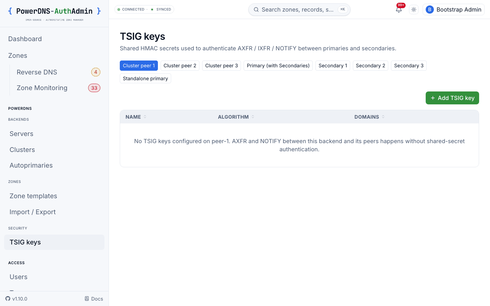
</picture>

---

## 8. Autoprimaries

- **What.** Configure supermaster registrations on a secondary PDNS so it auto-creates zones
  on NOTIFY from a registered primary. Gated on `autoprimary.manage`; audited as
  `autoprimary.create|delete`.
- **Where.** `lib/pdns/types.ts` (autoprimary schemas), `lib/pdns/client.ts`,
  `app/api/admin/pdns/autoprimaries/`, `app/(app)/admin/autoprimaries/`.

<picture>
  <source media="(prefers-color-scheme: dark)" srcset="../screenshots/dark/autoprimaries.png" />
  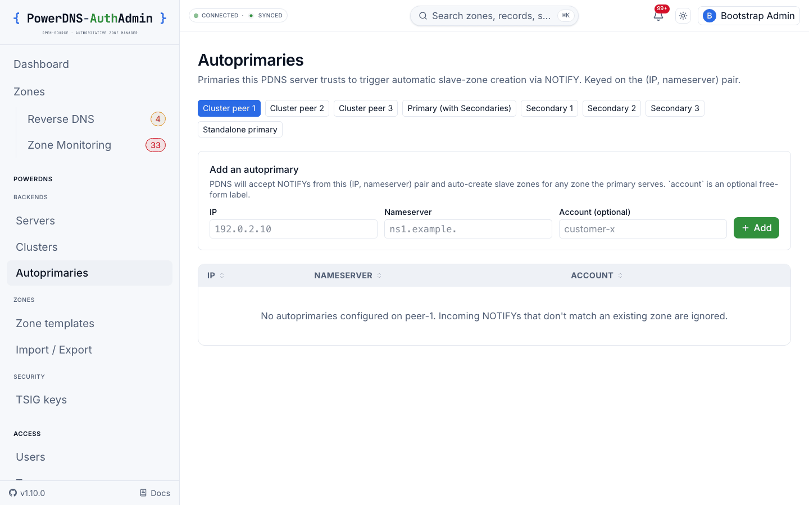
</picture>

---

## 9. Audit log

- **What.** Append-only log of every state-changing operation. Each row carries actor, action,
  resource, optional before/after JSONB snapshots, request context (IP, user-agent, request
  id), and a timestamp. Snapshots are auto-redacted for known secret field names.
- **Where.** `lib/audit/log.ts`, `lib/audit/actions.ts` (typed vocab), `lib/audit/redact.ts`,
  `app/(app)/admin/audit/`.
- **How.** Filter by actor, action, resource, time range from `/admin/audit` (gated on
  `audit.read`). Per-resource "Last admin edit" columns on every admin list page are derived
  from one batched query. Quick-filter chips cover the common incident-response queries
  (failed sign-ins, MFA admin changes, session revocations). Every row that originated a PDNS
  call carries a `req:` link that pivots to the matching rows in
  [the PDNS request log](#37-pdns-request-log), and CSV export honours the active filters.

<picture>
  <source media="(prefers-color-scheme: dark)" srcset="../screenshots/dark/audit-log.png" />
  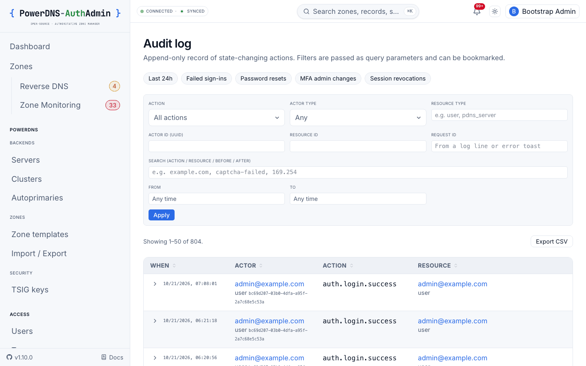
</picture>

### 9.2 Change log

- **What.** `/admin/changes` (sidebar **Logs → Change log**, beside the Request log and the
  Audit log) is the audit log filtered to what people _changed_: records, zones, DNSSEC, users
  and access (accounts, passwords, MFA, passkeys, tokens, sessions, roles, teams, zone grants)
  and configuration (backends, groups, settings, templates, TSIG keys, autoprimaries, sign-in
  providers, backup restore, provisioning). Sign-ins, reads, reveals, exports, NOTIFYs and
  notification dismissals stay in the Audit log. It is drawn with the zone page's own Change
  log component (same colour-coded chips, compact table and mobile cards, filters, paging and
  diffs) plus a **Zone** column (zone link and backend) and a **Category** filter; account and
  configuration changes expand to a field-by-field before/after. It loads the newest 1,000
  changes; `?zone=&server=` narrows it to one zone, which is where a zone page's **Show all
  changes** lands.
- **Classification.** `lib/audit/change-actions.ts` puts every action in the vocabulary in
  exactly one category or in its not-a-change list; a contract test fails when a new action is
  left unclassified.
- **Permission.** Global `audit.read`, the same as the Audit log, the Request log and the zone
  page's Change log tab. The **Logs** section shows only to users holding it globally (a
  team-scoped role does not pass the pages' gate, so it does not show the links either); a
  zone-grant holder without it is turned away like any other user.
- **Where.** `app/(app)/admin/changes/`, `lib/audit/change-actions.ts`,
  `lib/db/repositories/audit-log.ts` (`changeLogEntries`).

### 9.1 Audit action vocabulary

Every row's `action` is one of the strings below (`lib/audit/actions.ts` is the source of
truth; add there first). Names follow `<resource>.<verb>` and line up with the permission
vocabulary where a 1:1 mapping exists. Rows written before a rename keep the old name.

| Action                                                 | Written when                                                                                                                                                    |
| ------------------------------------------------------ | --------------------------------------------------------------------------------------------------------------------------------------------------------------- | -------- | ------------------------------------------------- |
| `auth.login.success`                                   | A sign-in completed (any method; `after.method` is `local`, `oidc`, `saml`, `ldap`, `webauthn-primary` or `webauthn-second-factor`, `after.provider` the slug). |
| `auth.login.failure`                                   | A sign-in was refused - bad credentials, lockout, captcha missing/failed, unverified email, MFA step failed.                                                    |
| `auth.logout`                                          | A session was ended by its owner.                                                                                                                               |
| `auth.password.changed`                                | A user changed their own password.                                                                                                                              |
| `auth.mfa.enrolled`                                    | TOTP enrolled on the actor's own account.                                                                                                                       |
| `auth.mfa.removed`                                     | TOTP removed (self-service, or by an admin - `actor` tells which).                                                                                              |
| `auth.mfa.webauthn.enrolled`                           | A passkey / security key was registered.                                                                                                                        |
| `auth.mfa.webauthn.removed`                            | A passkey / security key was deleted.                                                                                                                           |
| `auth.mfa.webauthn.renamed`                            | A passkey / security key was given a new label.                                                                                                                 |
| `auth.session.revoked`                                 | A user revoked one of their own sessions from `/profile`.                                                                                                       |
| `auth.token.issued`                                    | An API token was created (`after` carries prefix, scopes, expiry - never the secret).                                                                           |
| `auth.token.revoked`                                   | An API token was revoked.                                                                                                                                       |
| `auth.idp.linked`                                      | Reserved in the vocabulary - not emitted today; an SSO first sign-in that provisions a user writes `user.create`.                                               |
| `auth.idp.rejected_provisioning`                       | An SSO sign-in was refused before a user row was created (email domain not allowed, unverified email, disabled account).                                        |
| `auth.signup.rejected`                                 | A self-service signup was refused by the email-domain allow-list (`after` carries the domain only).                                                             |
| `auth.password.reset.requested`                        | A forgot-password request matched a real user and a reset token was minted.                                                                                     |
| `auth.password.reset.completed`                        | A reset token was redeemed and the password replaced (sessions revoked).                                                                                        |
| `auth.password.reset.invalid`                          | A reset token was rejected (expired, already used, bad signature).                                                                                              |
| `auth.email.verify.sent`                               | A verification token was minted for a user.                                                                                                                     |
| `auth.email.verify.completed`                          | An address was verified (`email_verified_at` set).                                                                                                              |
| `auth.email.verify.invalid`                            | A verification token was rejected.                                                                                                                              |
| `auth.email.change.requested`                          | A user asked to move their account to a new address (token bound to the new email).                                                                             |
| `auth.email.change.completed`                          | The new address was confirmed and swapped in.                                                                                                                   |
| `auth.email.change.invalid`                            | An email-change token was rejected.                                                                                                                             |
| `auth.group_sync.mapping_unresolved`                   | A group → role mapping named a role / team / server that no longer exists; the mapping was skipped (`after.provider`).                                          |
| `auth.token.idp_perms_refreshed`                       | An API token triggered a live IdP group re-fetch (one row per `IDP_PERMS_CACHE_TTL_SECONDS` window).                                                            |
| `user.create`                                          | A user was created by an admin, by signup (`after.source: signup`) or by SSO auto-provisioning.                                                                 |
| `user.update`                                          | Profile fields, flags or MFA requirement changed by an admin.                                                                                                   |
| `user.disable`                                         | An account was disabled.                                                                                                                                        |
| `user.enable`                                          | Reserved in the vocabulary - not emitted today; re-enabling is written as `user.update` (the PATCH route only splits out `user.disable`).                       |
| `user.delete`                                          | An account was deleted.                                                                                                                                         |
| `user.password.reset`                                  | An admin issued a temporary password (the reveal is a separate one-time read).                                                                                  |
| `user.session.revoked`                                 | An admin revoked one session of another user.                                                                                                                   |
| `user.sessions.revoked`                                | An admin revoked every session of one user.                                                                                                                     |
| `user.sessions.revoked_all`                            | An admin revoked every session in the system (`/api/admin/sessions`).                                                                                           |
| `team.create` / `team.update` / `team.delete`          | Team lifecycle.                                                                                                                                                 |
| `team.member.added` / `team.member.removed`            | Team membership changed.                                                                                                                                        |
| `role.create` / `role.update` / `role.delete`          | Role lifecycle (permissions, `requires_mfa`, description).                                                                                                      |
| `role.assignment.created` / `role.assignment.deleted`  | A `(user, role, scope)` assignment was issued or removed by an admin.                                                                                           |
| `settings.write`                                       | One or more settings changed on `/admin/settings` (before/after per key).                                                                                       |
| `audit.export`                                         | The audit log was exported as CSV (filters in `after`).                                                                                                         |
| `oidc.provider.created                                 | updated                                                                                                                                                         | deleted` | OIDC provider lifecycle (client secret redacted). |
| `oidc.provider.refresh-all`                            | Operator re-probed discovery for every enabled OIDC provider (one row per click).                                                                               |
| `saml.provider.created                                 | updated                                                                                                                                                         | deleted` | SAML provider lifecycle (SP keys redacted).       |
| `ldap.provider.created                                 | updated                                                                                                                                                         | deleted` | LDAP provider lifecycle (bind password redacted). |
| `pdns_server.refresh-all`                              | Operator re-probed every active backend's version / capabilities (one row per click).                                                                           |
| `backend_advisory.acknowledge`                         | An operator dismissed a health-bell advisory; the condition stays monitored.                                                                                    |
| `zone.create`                                          | A zone was created - UI, API, clone, template, import (`after.source`) or provisioning.                                                                         |
| `zone.update`                                          | Reserved in the vocabulary - not emitted today; zone-object changes are written as `zone.settings.update`.                                                      |
| `zone.delete`                                          | A zone was deleted (and its horizon classification dropped).                                                                                                    |
| `zone.notify`                                          | A NOTIFY was sent to the zone's secondaries (explicit, or as part of a write).                                                                                  |
| `zone.metadata.set` / `zone.metadata.delete`           | A metadata kind was written or removed.                                                                                                                         |
| `zone.settings.update`                                 | Kind, masters, SOA-EDIT(-API) or API-RECTIFY changed on the Zone settings tab.                                                                                  |
| `zone.horizon.update`                                  | A zone was reclassified public ↔ internal (§ 4.1.1).                                                                                                            |
| `zone.grant.create` / `zone.grant.delete`              | A per-zone grant was issued to or removed from a user or team (§ 2.5).                                                                                          |
| `zone.export`                                          | A zone was rendered as a BIND zonefile for download.                                                                                                            |
| `zone.tsig-transfer.set`                               | The zone's AXFR TSIG key was added or removed on primary + secondaries.                                                                                         |
| `dnssec.cryptokey.create                               | update                                                                                                                                                          | delete`  | A cryptokey changed (create also rectifies).      |
| `dnssec.enable` / `dnssec.disable` / `dnssec.rectify`  | Zone-level signing state changed or the zone was rectified (§ 5).                                                                                               |
| `record.create` / `record.update` / `record.delete`    | An RRset changed (before/after snapshots; DynDNS updates are `record.update` with `after.source: dyndns`).                                                      |
| `tsig.create` / `tsig.delete`                          | TSIG key lifecycle.                                                                                                                                             |
| `tsig.reveal`                                          | A key's secret was shown to an operator.                                                                                                                        |
| `tsig.install-secondaries`                             | A key was copied to the primary's secondaries over the TSIG API.                                                                                                |
| `tsig.manual-reveal`                                   | The `pdnsutil` install script (containing the secret) was generated.                                                                                            |
| `autoprimary.create` / `autoprimary.delete`            | Autoprimary (supermaster) registration changed.                                                                                                                 |
| `template.create                                       | update                                                                                                                                                          | delete`  | Zone template lifecycle.                          |
| `server.create` / `server.update` / `server.delete`    | PowerDNS backend lifecycle (API key redacted).                                                                                                                  |
| `server.cluster.assigned` / `server.cluster.removed`   | Reserved in the vocabulary - not emitted today; a group change is a `server.update` whose before/after carries `clusterId`.                                     |
| `cluster.create` / `cluster.update` / `cluster.delete` | Group / cluster lifecycle (peer-selection strategy).                                                                                                            |
| `provisioning.applied`                                 | First-boot provisioning finished (`after` carries per-block counts).                                                                                            |
| `provisioning.skipped`                                 | The file was present but the `provisioned_at` sentinel already existed.                                                                                         |
| `provisioning.failed`                                  | The applier aborted (the boot fails too).                                                                                                                       |
| `system.backup.exported`                               | The app-DB JSON backup was downloaded (`after` carries row counts per table).                                                                                   |
| `system.backup.restored`                               | A backup was merged into the database (`after` carries inserted counts per table).                                                                              |

---

## 10. Settings

- **What.** Operator-tunable runtime values: site name, support contact, login intro text,
  brand logo (https:// URL or inline data: URI), failed-login lockout policy, the
  self-service password-reset toggle (`allow_password_reset`), the default sign-in method
  (`auth_default_provider`, edited from `/admin/authentication`), the default TTL for
  new records (`default_record_ttl`, overridable per zone - see § 4.2) and automatic PTR
  maintenance (`auto_ptr`, off by default, overridable per zone - see § 4.8).
  `SETTINGS_RO=true` freezes the whole page (§ 17.1).
- **Where.** `lib/validators/settings.ts`, `app/(app)/admin/settings/`,
  `lib/settings/app-settings.ts`.

<picture>
  <source media="(prefers-color-scheme: dark)" srcset="../screenshots/dark/settings.png" />
  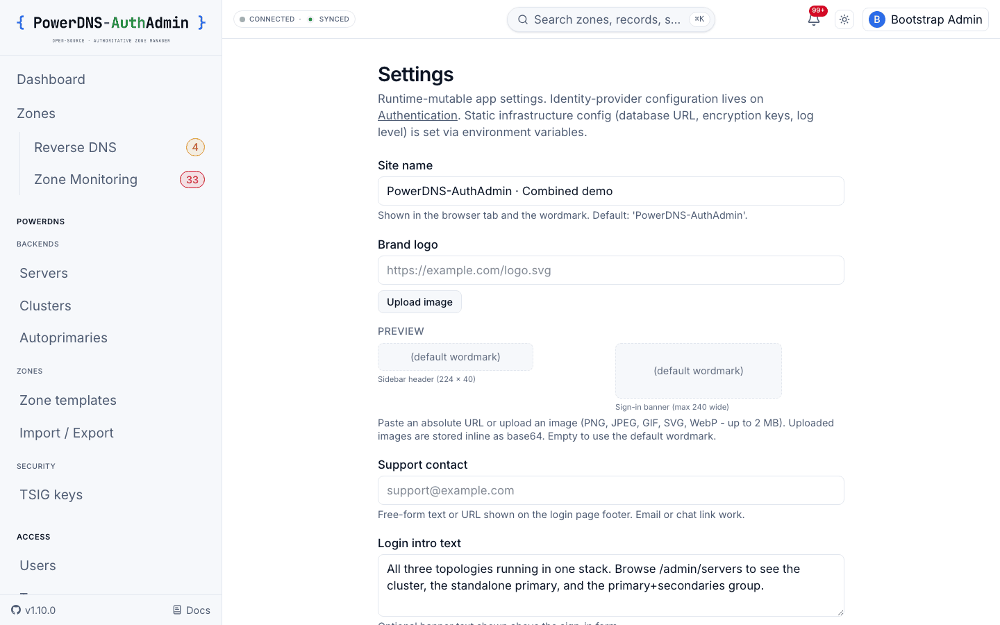
</picture>

### 10.1 Backup & Restore

- **What.** A super-admin wizard at `/admin/settings/backup` (every step inline, with a back
  button). **Export** streams a JSON dump of the app database - users, roles, assignments,
  teams, grants, tokens, providers, backends, clusters, templates, settings, advisories, the
  audit log - as `{ meta, tables }`. It deliberately excludes PowerDNS zone data (the daemon
  owns it) and the symmetric secrets (`APP_SECRET_KEY` / `APP_ENCRYPTION_KEY`, which stay in
  the environment); encrypted columns export as ciphertext, so the file is useless without the
  encryption key and safe to store next to the database. **Restore** is merge-mode only:
  every row is inserted with `ON CONFLICT DO NOTHING` in forward-FK order inside one
  transaction, guarded by a typed `RESTORE` confirmation, so it adds missing rows and never
  overwrites existing ones. The restore target must share the source's
  `APP_ENCRYPTION_KEY`. `SETTINGS_RO=true` blocks both directions (§ 17.1).
- **Where.** `app/(app)/admin/settings/backup/`, `app/api/admin/backup/{export,restore}/`,
  `lib/auth/settings-lock.ts`. Permission: `system.backup`, default-granted only to the seeded
  Super Admin role. Audit: `system.backup.exported|restored` with per-table row counts.
- **How.** For a true wipe-and-restore, or for PowerDNS zone data, use `pg_dump` /
  `sqlite3 .backup` and your PowerDNS backend's own backups - see
  [02-INSTALLATION → Backups](./02-INSTALLATION.md#backups).

---

## 11. Dashboard

- **What.** At-a-glance widgets for operator attention surfaces:
  - **Users** - locked-out, no-MFA, unverified, must-change-password counts.
  - **PDNS backends** - never probed, stale > 24h.
  - **OIDC providers** - never probed, failing discovery.

  Widgets are hidden when zero, so the dashboard stays quiet during steady-state.

- **PowerDNS metrics tab.** With `PDNS_BACKGROUND_POLLING=true`, a second tab charts each
  backend's `/statistics` over time - query rate, latency, cache hit ratio, response
  composition by qtype / rcode / size - from the `pdns_server_stats` time-series the poller
  samples every ~60 s (plus a 5-minute snapshot). Counter metrics are plotted as per-second
  rates, map metrics as donuts. Retention is pruned on the same cadence, bounded to the window
  the dashboard reads. With polling off the tab is hidden and the heading carries an `(i)` hint
  naming the env var.
- **Where.** `app/(app)/dashboard/page.tsx`, `lib/db/repositories/dashboard.ts`,
  `lib/metrics/{pdns-stats-sampler,dashboard-windows,retention}.ts`,
  `components/domain/pdns-stat-chart.tsx`; sampling lives in `lib/realtime/zone-poller.ts`.

<picture>
  <source media="(prefers-color-scheme: dark)" srcset="../screenshots/dark/dashboard.png" />
  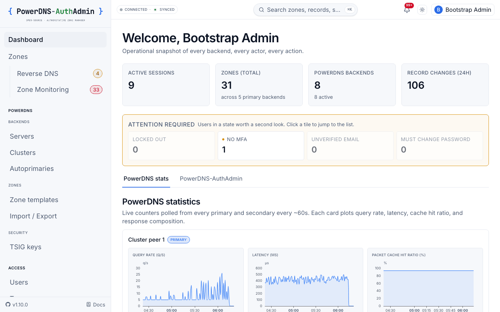
</picture>

---

## 12. Provisioning (first-boot YAML)

- **What.** A YAML file applied on first boot writes the operator's declarative state into the
  database: settings, custom roles, teams, zone templates, PDNS clusters, PDNS servers, OIDC /
  SAML / LDAP providers (each with group mappings), and demo zones - applied in that order.
  Role entries whose slug is a seeded system role are refused rather than overwritten. The
  applier writes a `settings.provisioned_at` sentinel on success; subsequent restarts skip
  the file.
- **Where.** `lib/provisioning/schema.ts` (Zod schema), `lib/provisioning/apply.ts`,
  `provisioning.example.yaml` (exhaustive reference).
- **How.** Set `PROVISIONING_FILE=/etc/.../provisioning.yaml` in the env, drop the file at
  that path, restart. To re-provision an existing database, delete the
  `settings.provisioned_at` row and restart.

---

## 13. Email / SMTP

- **What.** Optional transactional mail. With `SMTP_HOST` unset, `sendEmail()` no-ops with
  `{ ok: true, skipped: true }`; the email-verification and email-change flows then record
  their link on the audit row (`after.url`) for an operator to pass on, while the
  password-reset flow prints its link once in the server log (warn level) and never stores it
  in the audit log - the admin **Reset password** action on `/admin/users/<id>` is the
  supported alternative. With it set, three encryption shapes are supported:
  implicit TLS (`SMTP_SECURE=true`), STARTTLS required, STARTTLS opportunistic (default), or
  plaintext-only for local fakemail. AUTH is optional - omit `SMTP_USERNAME` + `SMTP_PASSWORD`
  for a relay that allow-lists this app's source IP.
- **Where.** `lib/email/transport.ts`, `lib/email/send.ts`, env validation in `lib/env.ts`.

---

## 14. Realtime

- **What.** SSE event bus that the zone list + zone detail subscribe to so external edits show
  up without a manual refresh. Backed by a single in-process zone-state poller; per-request
  PDNS calls are eliminated.
- **Where.** `lib/realtime/event-bus.ts`, `lib/realtime/zone-poller.ts`,
  `lib/pdns/zone-state-cache.ts`.
- **Self-healing stream.** The browser's own EventSource retry is not relied on: a tab that
  Safari or Chrome froze comes back with a stream that is dead but never errors, or stuck in
  CONNECTING for good, and the header chip would read "connecting" until a reload. The server
  sends a `heartbeat` message every 25 s (a data message, because SSE comments never reach the
  page), and the provider in `components/realtime/realtime-provider.tsx` reopens the stream
  when it has been silent for more than two heartbeats, has not opened within 10 s, or is
  closed. The check runs every 5 s while the tab is visible and immediately on tab show, window
  focus, network back and back-forward-cache restore, so the chip recovers within seconds of
  the operator returning. A reopen after a gap raises a client-side `realtime.reconnected`
  event with the length of the gap; pages that keep live tables subscribe to it and refetch
  what they may have missed. Nothing reloads the page. Policy:
  `components/realtime/reconnect-policy.ts`.

---

## 15. Observability

- **What.**
  - **Logs.** Pino structured JSON; secret-field redaction via `lib/errors/redact.ts`.
  - **Metrics.** Prometheus `/metrics`, always bearer-gated: `METRICS_TOKEN` (≥ 16 chars) is
    auto-generated if unset, and never logged (only a fingerprint), so pin one to scrape. `METRICS_ENABLED=false`
    removes the endpoint. Exposition is hand-built (`lib/metrics/exposition.ts`, metric
    names prefixed `pdnsauthadmin_`).
  - **Health.** `/healthz` (liveness) + `/readyz` (readiness - 200 when the database is
    reachable, 503 otherwise; it does not yet check migration state. Migrations run before
    the server starts listening, so a booted replica has already applied them).
  - **CSP violation reports.** `POST /api/csp-report` receives browser reports in both the
    legacy `report-uri` shape and the Reporting-API shape, logs them at warn level and
    answers 204. Unauthenticated by design (the most interesting violations come from
    visitors who aren't signed in), so it is IP rate-limited and truncates oversized bodies.
    Wired in via the `report-uri` + `report-to` directives the proxy emits.
- **Where.** `lib/logger.ts`, `app/metrics/`, `lib/metrics/`, `app/healthz/`, `app/readyz/`,
  `app/api/csp-report/`, `lib/security/csp.ts`.

---

## 16. Deployment

### 16.1 Single image

- **What.** One Docker image, no external CDN. Migrations run in the entrypoint at boot
  (ADR 0011); on Postgres they're serialized by `pg_advisory_lock` so multi-replica boots are
  safe. `MIGRATE_ON_BOOT=false` opts out for CI/CD-driven migration workflows.
- **Where.** `Dockerfile`, `docker/entrypoint.mjs`, `scripts/migrate.ts`.

### 16.2 Compose stacks

All stacks use the official `powerdns/pdns-auth` image - there is no custom PowerDNS build.

- `docker-compose.yml` - the **minimal-demo stack**: SQLite app (published
  `ghcr.io/powerdns-authadmin/powerdns-authadmin` image) + a bundled standalone PowerDNS, pre-seeded with 10 demo
  zones (via `provisioning.minimal-demo.yaml`). The fastest way to try it.
- `docker-compose-primary-secondaries.yml` - primary + three secondaries with supermaster
  auto-bootstrap.
- `docker-compose-multi-primary.yml` - three writable peers sharing MariaDB.
- `docker-compose-combined.yml` - all three topologies in one stack with seeded demo zones.
- `docker-compose.ha.yml` - Postgres + Redis with three app replicas behind your own load
  balancer; the reference for [running more than one replica](../README.md#high-availability-replicas--1)
  (ADR-0016).

### 16.3 Storage

Postgres (recommended) and SQLite both supported. Schema lives in parallel
`lib/db/schema/` (pg) + `lib/db/schema-sqlite/` directories. Each emits its own migration
folder (`drizzle/`, `drizzle-sqlite/`); the boot entrypoint picks one based on
`DATABASE_URL`'s scheme.

---

## 17. Security posture

- **Per-request CSP nonce** (ADR 0006) so injected `<script>` tags don't execute.
- **CSRF double-submit** on every mutating route via `requireCsrf(request)`.
- **SSRF guard** on PDNS base URLs (§ 3.9).
- **Encryption envelope** for at-rest secrets - versioned AES-256-GCM via HKDF-SHA-256
  subkeys per usage (`lib/crypto/encryption.ts`).
- **Secret-field redaction** in audit `before`/`after` snapshots and free-form log strings.
- **Argon2id** with OWASP 2024 parameters for passwords and API tokens.
- **No telemetry phone-home.** Air-gapped enterprises are first-class. The only background
  traffic that can leave the network is zone monitoring's outbound DNS (§ 20.8) and the
  Reverse DNS checks' upstream PTR lookups (§ 4.8), both off by default and switched on with
  `ZONE_MONITOR_ENABLED=true` / `REVERSE_DNS_ENABLED=true`.
- **`SECURITY.md`** for the vulnerability disclosure policy.

### 17.1 Public-demo locks (`BOOTSTRAP_ADMIN_RO`, `SETTINGS_RO`)

- **What.** Two env switches for an install whose login is published (the hosted demo). Both
  are pure env flags - no schema column, no migration - and no-ops when off, so real installs
  are unaffected.
  - **`BOOTSTRAP_ADMIN_RO=true`** (requires `BOOTSTRAP_ADMIN_EMAIL`) freezes the bootstrap
    admin's own identity and credentials: password, email, name, TOTP / passkey enrolment,
    disable / delete and role changes all return 403, whether attempted from `/profile` or by
    another admin. Everything else the account can do is untouched - it is an identity lock,
    not a read-only mode. The seed creates the account already compliant
    (`must_change_password=false`) because it can no longer change its password.
  - **`SETTINGS_RO=true`** freezes the whole Settings surface: `PATCH /api/admin/settings`
    returns 403 for everyone, the form renders read-only, and Backup & Restore (§ 10.1) is
    disabled in both directions.
- **Where.** `lib/auth/bootstrap-admin.ts` (`isBootstrapAdminLocked` /
  `assertBootstrapAdminMutable`), `lib/auth/settings-lock.ts` (`isSettingsReadOnly` /
  `assertSettingsMutable` / `assertSettingsBackupAllowed`). Enforcement is at the route
  handlers; the disabled UI affordances only exist to avoid dead-end clicks.

---

## 18. API

- Every admin surface has a corresponding `/api/admin/...` route handler. Routes accept
  either a session cookie (UI clients) or `Authorization: Bearer pda_pat_…` /
  `X-API-Key: pda_pat_…` (API clients).
- Mutating routes require `x-csrf-token`. The client wrapper `lib/client/api-fetch.ts` adds
  it automatically; programmatic clients omit it when authenticating via a PAT (the PAT itself
  proves the request is intentional).
- The full route surface mirrors the admin UI - see `app/api/admin/` and `app/api/profile/`.

### 18.1 DynDNS (`GET /nic/update`)

- **What.** A DynDNS 2 endpoint for routers and `ddclient`-style updaters, so an existing
  dynamic-DNS setup can point at AuthAdmin without a custom script. The client authenticates
  with **HTTP Basic** where the user is the account **email** and the password is one of that
  account's **API tokens** (`pda_pat_…`). The token must carry `record.update`, held either
  globally or through a per-zone grant for the zone the hostname falls under (§ 2.5). The
  route lists the zones of every active backend, picks the **longest matching zone** for the
  hostname (label-anchored, so `evil-example.com` never matches `example.com`) and replaces
  the hostname's `A` or `AAAA` RRset - chosen by the shape of the IP - with TTL 300. The
  update is audited as `record.update` with `after.source: dyndns`.
- **Contract.** As the protocol demands, the response is **always HTTP 200** with a
  `text/plain` body the client parses: `good <ip>` on success, `badauth` (with a Basic
  challenge), `nohost` (no matching zone, or no permission on it), `notfqdn` (missing or
  single-label hostname), `numhost` (comma-separated hostname lists are not supported),
  `dnserr` (PowerDNS refused the write, or no usable IP). `myip` may be an explicit IPv4/IPv6
  address, omitted, or `auto` - the last two use the client's source address as seen through
  the fronting proxy's `X-Forwarded-For` (`lib/client-ip.ts`), so run the usual trusted
  proxy in front.
- **Where.** `app/nic/update/route.ts` (the orchestrator), `lib/dyndns/parse.ts` (pure
  request parsing, response formatting and zone matching; fuzz-tested).
- **How.** Create a token on `/profile#api-tokens` scoped to `record.update` for a user who
  holds that permission on the zone, then point the client at `/nic/update`. A working
  `ddclient.conf`:

  ```ini
  daemon=300
  protocol=dyndns2
  use=web, web=https://api.ipify.org/      # or: use=if, if=eth0 - sent as ?myip=
  ssl=yes
  server=dns.example.com                    # your APP_URL host; the path /nic/update is implied
  login=ops@example.com                     # the account's email
  password='pda_pat_xxxxxxxxxxxxxxxxxxxxxxxx'
  home.example.com                          # one hostname per line - no comma lists
  ```

  `ddclient` then issues
  `GET https://dns.example.com/nic/update?system=dyndns&hostname=home.example.com&myip=203.0.113.7`
  and expects `good 203.0.113.7` back. Extra query parameters such as `system` are ignored.

---

### 18.2 MCP server (natural-language DNS)

- **What.** `POST /api/mcp` is a Model Context Protocol server (Streamable HTTP, stateless,
  JSON responses) authenticated with a personal access token. It exposes task-shaped tools -
  `list_backends`, `list_zones`, `find_zones`, `get_zone`, `list_records`, `records_at`,
  `set_records`, `add_record`, `delete_records`, `create_zone`, `delete_zone`,
  `zone_sync_status`, `reverse_dns_report`, `reverse_dns_links`, `reverse_dns_rectify`,
  `zone_monitoring`, `zone_monitoring_refresh`, `search`, `list_notifications`,
  `dismiss_notifications` - so Claude Code, Codex, Cursor or any MCP
  client can manage zones, maintain reverse DNS and read the monitoring from a prompt. Every
  feature in the UI has a tool counterpart; the tool table in the operator guide is the
  contract. Reads go through the same
  `canActOnZone` gate as the pages; writes are dispatched into the existing REST route
  handlers, so RBAC ceilings, validation, optimistic concurrency, audit and NOTIFY are the
  ones the UI uses. Write tools are only advertised to tokens that can write somewhere;
  browser sessions are refused on the endpoint.
- **Where.** `app/api/mcp/route.ts`, `app/api/mcp/_server.ts`, `app/api/mcp/_dispatch.ts`,
  `app/api/mcp/_records.ts`. Operator guide: [`docs/14-MCP.md`](./14-MCP.md).

## 19. Operator UX & responsive design

Landed in v1.1.4 ([#51](https://github.com/PowerDNS-AuthAdmin/powerdns-authadmin/issues/51) /
[PR #52](https://github.com/PowerDNS-AuthAdmin/powerdns-authadmin/pull/52)) - a top-to-bottom
pass to make the operator surface usable on phones without giving up the dense desktop
information density. Every screenshot in [`screenshots/`](../screenshots/README.md) is from
this baseline.

### 19.1 Mobile-first responsive shell

- **What.** Off-canvas hamburger drawer for navigation under `md`; full sidebar from `md+`.
  Drawer closes on backdrop tap, Esc, and route changes (no in-drawer close button needed).
  The top bar reflows: hamburger + status chip + bell + theme + avatar, all reachable at
  320 px.
- **Where.** `components/ui/app-shell.tsx`, `app/(app)/layout.tsx`.

<p align="center">
  <picture>
    <source media="(prefers-color-scheme: dark)" srcset="../screenshots/dark/dashboard-mobile.png" />
    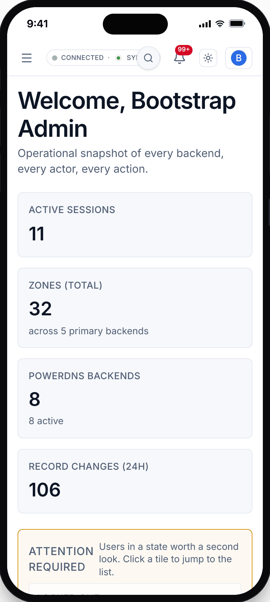
  </picture>
  &nbsp;
  <picture>
    <source media="(prefers-color-scheme: dark)" srcset="../screenshots/dark/zones-list-mobile.png" />
    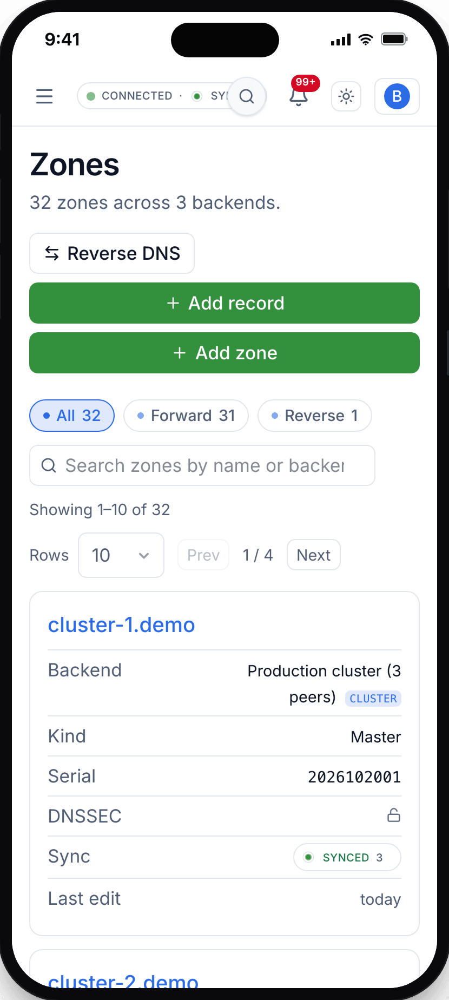
  </picture>
</p>

### 19.2 One DataTable, every list

- **What.** Every list view (zones, users, roles, teams, authentication providers, TSIG keys,
  autoprimaries, zone templates, audit log, PDNS request log, sessions, profile sessions,
  servers, dashboard sub-tables, role assignments, team members, zone change history) uses
  the same `<DataTable>` recipe. Desktop: `bg-bg-muted` thead, `even:bg-bg-subtle` striping,
  accent-tinted hover wash, sticky search + sort + per-column meta widths. Mobile (< md):
  each row reflows to a labelled card automatically - no horizontal scroll, no truncated
  cells. Row details across the app (zone change history, audit log, PDNS request log,
  Reverse DNS, Zone Monitoring) open through a single chevron accordion in front of the
  first column, one row at a time, so a tall detail never pushes the rows being compared
  off screen.
- **Where.** `components/ui/data-table.tsx`, `components/ui/row-disclosure.tsx`. The Audit
  Log + Profile Sessions + OIDC Providers + TSIG Keys + Autoprimaries were the final
  hold-outs converted in v1.1.4.

### 19.3 Live header status chip

- **What.** Single pill in the top bar showing `CONNECTING / CONNECTED / OFFLINE / PAUSED`
  (SSE connection state) plus a trailing `· SYNCED / · DESYNCED` whenever the page has a
  notion of sync state. Off-the-shelf default is the fleet-wide `globalAnyLagging()` verdict
  computed from the in-process zone-state cache (no extra PDNS hit); per-page
  `<HeaderStatusMode/>` overrides on zone-detail, zones-list, and the servers page. A 5 s
  grace prevents "OFFLINE" flashes on Ctrl-R.
- **Where.** `components/realtime/header-status-chip.tsx`,
  `components/realtime/realtime-provider.tsx`, `lib/pdns/sync.ts` (`globalAnyLagging`).

### 19.4 Animated SyncIndicator

- **What.** Concentric-ring SVG glyph used everywhere a sync verdict is displayed (header
  chip, zones list per-row chip, servers table). **Synced** = solid centre + two
  outward-pulsing rings via staggered CSS keyframes - a continuous radar/sonar ping.
  **Desynced** = hollow centre + two dashed concentric rings that counter-rotate via
  `stroke-dashoffset` so the icon reads as _actively trying_ rather than as a frozen error.
  Honours `prefers-reduced-motion`.
- **Where.** `components/ui/sync-indicator.tsx`, `app/globals.css` (`pda-sync-pulse` +
  `pda-desync-spin*` keyframes).

### 19.5 One-button theme toggle

- **What.** Was three buttons (sun / monitor / moon). Now one button whose icon mirrors the
  active preference and cycles `light → dark → system → light` on click. The pre-hydration
  script in `app/layout.tsx` still applies the `.dark` class before React mounts so there's
  no flash of wrong theme.
- **Where.** `components/ui/theme-toggle.tsx`.

### 19.6 Capability badges + clickable rows

- **What.** Per-backend badges (`CLUSTER` / `DEFAULT` / `PRIMARY` / `READ-ONLY MIRROR`) match
  the visual vocabulary across servers, zones, audit. Every table row + mobile card is
  clickable to the detail view; embedded links/buttons (Edit / Delete / Refresh) intercept the
  click so per-row actions still work.
- **Where.** `components/domain/capability-badges.tsx`, `components/ui/clickable-row.tsx`.

### 19.7 Diff-before-apply (record edits)

The per-RRset editor now insists on a **Review changes** modal between Save and the actual
PATCH - see [§ 4.2](#42-per-rrset-editor-with-diff-before-apply) for the full story. Validation
errors are gated behind an explicit "Save anyway" checkbox so an override is never accidental.

### 19.8 Inline record editing

- **What.** Enter on a row, a double-click, or the row's **Edit** button opens an edit strip
  directly beneath the record: TTL, value (the same structured MX / SRV / CAA / TXT editors
  the dialog uses) and the disabled flag. Enter stages the change, Esc backs out. Anything
  that would move the record to a different RRset - name, type, comment - escalates to the
  full dialog via **Full editor…** (or `E` on the row), carrying the in-progress draft along.
  Both paths stage through the same code and land in the same **Review changes** diff
  (§ 19.7), so there is one route to PowerDNS whichever editor the operator used.
- **Where.** `app/(app)/zones/[zoneId]/_components/editable-record-table.tsx`
  (`InlineRecordEditor`, `stageDraft`); row hooks via `DataTable`'s `getRowProps`.

### 19.9 Keyboard model

- **What.** The records table is fully drivable without a mouse: `/` focuses search (Esc
  clears it, Esc again leaves it), `N` opens Add record, `↑`/`↓` move between rows,
  `Enter` edits in place, `E` opens the full editor, `Delete` deletes. The editor and review
  dialogs are real forms - Enter reviews, Enter again saves, Esc steps back one level. A
  legend under the table lists the keys.
- **Selects are combo boxes.** `<SelectMenu>` follows the native `<select>` habits: on a
  closed menu `T` picks TXT, `T` again TLSA, `TL` TLSA directly; `↑`/`↓`/Home/End/PgUp/PgDn
  move the highlight, Enter or Space picks, Esc closes just the menu (the dialog around it
  stays open). Lists of ten or more options get a filter box that matches label _and_
  description, so `ipv6` finds AAAA and `mail` finds MX. The record-type menu shows each
  type's plain-English name as the second line.
- **Where.** `components/ui/select-menu.tsx` (+ `select-menu-keys.ts`, unit-tested),
  `components/ui/data-table.tsx` (`searchShortcut`, `getRowProps`).

### 19.11 Global search

- **What.** A header search palette (the **Search…** button, `Ctrl K` / `⌘K`, or `/` when
  focus is not in a text field and the page has no primary list that already owns `/`) that
  fuzzy-matches zones, records, config, the PowerDNS request log and the audit log. Letters can
  be skipped (`exmp` finds `example.com`); matches are highlighted, and prefixes, word
  boundaries (after `.`, `-`, `_`, space, `@`, `/`) and runs of consecutive letters rank
  higher. It opens as a floating panel on desktop and a full-screen sheet on phones.
- **Tabs.** **All** covers zones, records and config and shows the best six of each group with
  labels. **Requests** and **Audit** sit apart, after a divider labelled "Logs": the logs are
  searched only when their own tab is picked, never under **All**, and are never remembered as
  the tab to open with, so the everyday search stays small and fast (their tabs show no count
  until picked). **Zones**, **Records**,
  **Config**, **Requests** and **Audit** each show up to 25 hits with that tab's columns
  inline (zones: backend, horizon, kind; records: type, value, zone; config: section, value;
  requests: method, status, backend, time; audit: actor, resource, time), collapsing to a
  subtitle line on phones. The content tabs show their match counts; the last content tab is
  remembered per browser. **Config** covers app settings and their current values, admin pages by title,
  backends (slug, name, URL host only), clusters, users (name, email), teams, roles, zone
  templates and sign-in providers (name and slug only). **Requests** and **Audit** match the
  newest 500 rows of each log.
- **Permissions.** Each source is filtered on its own with the permission its page uses:
  `zone.read` / `record.read` per zone (global or a zone grant on that backend), then
  `settings.read`, `server.read`, `user.read`, `team.read` (team-scoped owners see their own
  teams), `role.read`, `template.use`, `auth.read`, `system.backup` and `audit.read`. Tabs the
  user cannot use are hidden. A user with no roles gets empty results, not an error.
- **Never returned.** Password hashes, API tokens, session ids, TSIG key material, OIDC / SAML
  / LDAP client secrets, signing keys and bind passwords, PowerDNS API keys, encryption keys,
  SMTP passwords, WebAuthn credentials, backup contents, request headers and bodies, and audit
  before/after snapshots. Docs are not searched either: the footer link **Looking for docs
  instead? Search powerdns-authadmin.org** hands the query to the website's search.
- **Keys.** `↑`/`↓`, Home and End move, `←`/`→` switch tabs, Enter opens, Shift+Enter or a
  Cmd/Ctrl click opens a new tab, Esc closes and returns focus to the trigger. A record hit
  opens its zone with the record table already filtered (`?q=`); a request or audit hit opens
  the log with its filters set.
- **Speed: a prebuilt, hot-swapped index.** Reading zones, records, settings, people and the
  logs happens in the background, never on a keystroke (`lib/search/search-index.ts`). A query
  is permission filtering and fuzzy scoring over a snapshot already in memory. Zone, audit and
  request-log events mark the index stale; a 0.75 s debounce folds a burst of changes into one
  rebuild (request-log-only changes at most every 15 s), and a five-minute rebuild catches
  edits made directly on a backend. A rebuild builds a complete new snapshot and swaps it in
  with one assignment, so queries keep being answered from the previous snapshot while it
  runs and nothing ever sees half an index; a failed rebuild keeps the previous one. After each
  swap the server publishes `search.index.updated` and an open palette re-runs its query in
  place, keeping the results and the selection on screen until the new answer arrives. The
  palette also keeps the last 50 answers, so typing back and forth is instant; they are dropped
  on every swap. The index is warmed on the first page render after boot.
- **Where.** `components/domain/global-search.tsx`, `components/ui/search-trigger.tsx`,
  `lib/search/` (`fuzzy.ts`, `index.ts`, `sources.ts`), `app/api/search/route.ts`
  (`GET /api/search?q=&scope=`, about 60 requests a minute per user), MCP tool `search`.

### 19.10 Compliance hard-stops

- **What.** Operators with `must_change_password = true` or unmet MFA-per-role requirements
  are pinned to `/profile` (or an allow-list of self-service routes) on every navigation -
  not just the initial render. The header status chip is suppressed in that state because
  the SSE endpoint would 403 the request, which would otherwise leave the chip stuck on
  `CONNECTING`.
- **Where.** `lib/auth/require-user.ts` (page gate), `app/(app)/layout.tsx` (compliance
  redirect), `components/auth/compliance-guard.tsx` (client-side intercept).

---

## 20. Zone monitoring

A zone that PowerDNS serves correctly can still be broken for everyone else: the registrar
points at the wrong nameservers, the DS at the parent no longer matches the DNSKEY after a key
rollover, a secondary stopped transferring, or a nameserver hands the whole zone to anyone who
asks for it. None of that is visible from inside PowerDNS, so AuthAdmin checks every hosted zone
from the outside on a schedule and reports what it finds on **Zones → Zone Monitoring**
(`/zones/monitoring`), in the notification bell and as a count on the sidebar entry.

**Opt-in.** Zone monitoring is off by default because it adds background load and sends DNS
queries outside your network. Set `ZONE_MONITOR_ENABLED=true` to turn it on. While it is off,
the page, its sidebar entry, `GET /api/admin/monitoring/zones`, the refresh route and the
`zone_monitoring*` MCP tools do not exist (404), and findings left from an earlier run are
removed from the bell once at start-up. The reverse-DNS drift finding below also needs
`REVERSE_DNS_ENABLED=true`.

### 20.1 What is checked, and why from the outside

- **Delegation at the parent.** The parent's NS set, its glue and its DS records are read by
  walking down from the root servers (root, TLD, parent) the way a resolver does, not by asking
  a recursive resolver. A recursive resolver answers from its cache and from the zone's own
  nameservers, so it cannot show what the parent says, and a broken or lying resolver would make
  a correct delegation look wrong. The root addresses are the published root hints, compiled in
  (`lib/dns/root-hints.ts`) and rotated so repeated walks spread across the roots. Public zones
  only; an internal zone has no delegation on the internet to compare against.
- **Nameservers.** Every NS name at the apex is resolved (glue in the zone first, then the
  parent's glue, then a lookup) and each address, at most two per name, is asked for the zone's
  SOA without recursion: did it answer, with `NOERROR` and the AA flag, and with which serial. A
  server that answered authoritatively is also asked for the apex NS RRset, so a nameserver
  serving a different NS set than PowerDNS is caught, and is sent the transfer probe below.
- **Open zone transfer.** An AXFR without a TSIG key, over TCP, against the zone's own
  nameservers only. Reading stops at the first message: a server that is going to refuse does
  so at once, and one that answers has already proven the leak, so a large zone is never pulled
  in full (256 KiB cap).
- **DNSSEC chain.** When PowerDNS has the zone signed, the DNSKEY RRset is read from an
  authoritative nameserver and compared with the DS at the parent by key tag and algorithm: a
  signed zone without a DS, a DS for an unsigned zone, or a DS matching no key. Signatures are
  not validated; the chain of trust is checked, not the RRSIGs.
- **Resolver view.** The zone's SOA is asked, with recursion, of the configured resolvers: the
  public ones for a public zone, the internal ones for an internal zone. `SERVFAIL` or
  `NXDOMAIN` there is the symptom the zone's users see; a serial lower than PowerDNS is only a
  cache that has not expired yet.
- **SOA sanity.** From the PowerDNS copy: refresh, retry, expire and minimum against RFC 1912
  and RFC 2308, MNAME present in the NS set (NOTIFY and dynamic updates target it), RNAME shaped
  like a mailbox.
- **Reverse DNS drift.** The Reverse DNS reconciliation (§ 4.8) is tallied per forward zone:
  addresses without a PTR, and addresses whose PTR names something else, counting only
  addresses covered by a hosted reverse zone of the same horizon.

The wire client behind all of this (`lib/dns/wire.ts`) exists because `node:dns` hides exactly
what these checks need: the authority section of a referral, the AA flag, a serial per
nameserver address, and the ability to ask for a transfer. It speaks IN class only, decodes the
record types a delegation check reads (NS, A, AAAA, SOA, CNAME, PTR, MX, TXT, DS, DNSKEY,
RRSIG), sets EDNS0 with the DO bit when asked, retries one lost UDP datagram once, falls back
to TCP on truncation, and caps every TCP response.

### 20.2 Findings

Each check produces findings with a stable code, a severity and a detail text naming the
addresses, serials or key tags involved. Severity policy: **error**: resolvers are, or soon
will be, failing to answer for the zone; **warn**: the zone works but is fragile or
inconsistent; **info**: worth knowing, nothing to fix today. A zone without findings is **OK**.
Findings are sorted worst first, and a zone's verdict is its worst finding.

A finding can carry a **suggested fix** (`fix` on the finding in
`GET /api/admin/monitoring/zones`): pure data from `lib/dns/zone-checks.ts`, shown as one line
under the finding with a **Fix** button. Fix opens **Review changes** with the BIND-style
before/after, and **Save** applies it through the route a manual edit uses, so permissions,
validation, audit and NOTIFY are the same. The first fix is `soa.mname`: the MNAME becomes the
first apex NS in the zone's order, preferring one the parent also delegates to (the PowerDNS
placeholders `a.misconfigured.powerdns.server.` and `a.misconfigured.dns.server.invalid.` are
named as such in the detail). The dialog reads the live SOA
(`GET /api/admin/pdns/zones/<zone>/records?type=SOA`, `zone.read` + `record.read`), replaces
only the first field, keeps the serial and timers (PowerDNS raises the serial on save per
SOA-EDIT-API) and saves with `PATCH /api/admin/pdns/zones/<zone>/rrsets`, which charges an SOA
change to `soa.update` on the zone (global role or zone grant), exactly as the zone's SOA panel
does. The zone is then re-checked so the finding clears; a 403 is reported as "You don't have
permission to change this zone's SOA".

| Code                                                    | Severity                                                                                                                       | Meaning                                                                                                                                                                                                                                                                                                                                            | What to do                                                                                                                              |
| ------------------------------------------------------- | ------------------------------------------------------------------------------------------------------------------------------ | -------------------------------------------------------------------------------------------------------------------------------------------------------------------------------------------------------------------------------------------------------------------------------------------------------------------------------------------------- | --------------------------------------------------------------------------------------------------------------------------------------- |
| `delegation.missing`                                    | error                                                                                                                          | The parent answers `NXDOMAIN` or gives no referral for the zone. Resolvers on the internet cannot reach it.                                                                                                                                                                                                                                        | Create the delegation at the registrar or with the parent zone's operator.                                                              |
| `delegation.ns-mismatch`                                | error when the parent's and the apex NS sets share no name, warn when they overlap                                             | The NS names the parent delegates to differ from the zone's apex NS RRset. The detail lists both sides and the difference.                                                                                                                                                                                                                         | Make the registrar's nameserver list and the zone's NS RRset identical.                                                                 |
| `delegation.glue-mismatch`                              | warn                                                                                                                           | The parent's glue for an in-bailiwick nameserver differs from the A/AAAA the zone holds for it.                                                                                                                                                                                                                                                    | Update the glue (host records) at the registrar.                                                                                        |
| `delegation.served-by-parent`                           | info                                                                                                                           | The parent's servers answer authoritatively for the zone themselves; there is no separate delegation to compare.                                                                                                                                                                                                                                   | Nothing. Expected when parent and child are served by the same nameservers.                                                             |
| `delegation.unverified`                                 | info                                                                                                                           | The walk from the roots failed: no root server answered, or a nameserver on the path had no address.                                                                                                                                                                                                                                               | Check outbound DNS from the AuthAdmin host; set `ZONE_MONITOR_ENABLED=false` if it is blocked on purpose.                               |
| `dnssec.ds-missing`                                     | warn                                                                                                                           | The zone publishes DNSKEYs but the parent has no DS, so validators treat it as unsigned.                                                                                                                                                                                                                                                           | Publish the DS (key tags in the detail) at the registrar.                                                                               |
| `dnssec.ds-orphan`                                      | error                                                                                                                          | The parent publishes a DS and the zone serves no DNSKEY. Validating resolvers return `SERVFAIL` for every name in the zone.                                                                                                                                                                                                                        | Remove the DS at the parent, or re-sign the zone.                                                                                       |
| `dnssec.ds-stale`                                       | error                                                                                                                          | No DS at the parent matches a DNSKEY by key tag and algorithm; a key rollover was not completed.                                                                                                                                                                                                                                                   | Replace the DS at the parent with the current KSK's.                                                                                    |
| `nameserver.none`                                       | error                                                                                                                          | No NS RRset at the apex.                                                                                                                                                                                                                                                                                                                           | Add NS records.                                                                                                                         |
| `nameserver.count`                                      | warn (info for internal zones, or when accepted)                                                                               | A single nameserver (RFC 2182). A single internal nameserver is a common design, so for an internal zone it stays on the page and does not ring the bell. A standalone backend can accept it in its server settings (**Don't warn about single-nameserver zones on this backend**); the finding then reads "(accepted)" and stays out of the bell. | Add a second, independent nameserver.                                                                                                   |
| `nameserver.cname`                                      | warn                                                                                                                           | An NS target is a CNAME (RFC 2181 § 10.3).                                                                                                                                                                                                                                                                                                         | Point the NS record at a hostname that has A/AAAA records.                                                                              |
| `nameserver.no-address`                                 | error                                                                                                                          | The NS name resolves to no A/AAAA, so nobody can query it.                                                                                                                                                                                                                                                                                         | Add address records (and glue at the parent when in-bailiwick).                                                                         |
| `nameserver.private-address`                            | warn (public zones only)                                                                                                       | The NS name resolves to loopback, RFC 1918, CGNAT or ULA space, unreachable from the internet. Such addresses are not probed.                                                                                                                                                                                                                      | Publish a routable address, or classify the zone as internal (§ 4.1.1).                                                                 |
| `nameserver.unreachable`                                | error                                                                                                                          | None of the nameserver's probed addresses answered within the timeout.                                                                                                                                                                                                                                                                             | Check the server and its firewall on 53/udp and 53/tcp.                                                                                 |
| `nameserver.partially-unreachable`                      | warn                                                                                                                           | Some of the nameserver's addresses answered, others did not.                                                                                                                                                                                                                                                                                       | Fix or remove the dead address.                                                                                                         |
| `nameserver.lame`                                       | error                                                                                                                          | The server answered without the AA flag or with an rcode other than `NOERROR`: the delegation points at a server not serving the zone.                                                                                                                                                                                                             | Load the zone on that server, or drop it from the NS set and the delegation.                                                            |
| `nameserver.diversity`                                  | info                                                                                                                           | Every nameserver address sits in one /24 (IPv4) or /48 (IPv6); one network outage takes the zone offline (RFC 2182 § 3.1).                                                                                                                                                                                                                         | Add a nameserver on another network.                                                                                                    |
| `consistency.ns-set`                                    | warn                                                                                                                           | A nameserver answers a different NS RRset than PowerDNS holds.                                                                                                                                                                                                                                                                                     | Let the secondary transfer; fix the stale copy.                                                                                         |
| `consistency.serial`                                    | warn                                                                                                                           | Nameservers disagree with each other, or with the serial PowerDNS serves (`edited_serial`, so SOA-EDIT and SOA-EDIT-API zones compare correctly), on the SOA serial.                                                                                                                                                                               | Check AXFR and NOTIFY to the lagging secondary (zone Sync tab, § 3.4; TSIG, § 7).                                                       |
| `transfer.open`                                         | error for public zones, warn for internal                                                                                      | A nameserver answered an unsigned AXFR for the zone.                                                                                                                                                                                                                                                                                               | Restrict transfers: `allow-axfr-ips`, the `ALLOW-AXFR-FROM` zone metadata (§ 6), TSIG.                                                  |
| `soa.missing`                                           | error                                                                                                                          | No SOA at the apex.                                                                                                                                                                                                                                                                                                                                | Add the SOA.                                                                                                                            |
| `soa.timers`                                            | error when expire is not above refresh + retry, else warn                                                                      | Refresh below 20 minutes, retry not below refresh, expire not above refresh + retry or below one week, minimum above one day.                                                                                                                                                                                                                      | Adjust the SOA timers (RFC 1912 § 2.2, RFC 2308 § 4), or the zone template that seeds them (§ 4.4).                                     |
| `soa.mname`                                             | warn                                                                                                                           | The SOA MNAME is not one of the zone's nameservers (RFC 1996). When it is `a.misconfigured.powerdns.server.`, the placeholder PowerDNS writes without `default-soa-content`, the detail says so.                                                                                                                                                   | Set MNAME to the primary's NS name, and `default-soa-content` in pdns.conf for new zones.                                               |
| `soa.rname`                                             | info                                                                                                                           | The RNAME has no `.` or contains `@`; it should be a mailbox with the `@` written as `.`.                                                                                                                                                                                                                                                          | Correct the RNAME (`hostmaster.example.com.`).                                                                                          |
| `resolution.public` / `resolution.internal`             | error on `SERVFAIL` or `NXDOMAIN`; warn on any other rcode; no answer: warn for a public resolver and a public zone, else info | What a recursive resolver returns for the zone's SOA. `SERVFAIL` means a broken DNSSEC chain, a lame delegation or unreachable nameservers from that resolver's point of view; `NXDOMAIN` means it does not see the delegation.                                                                                                                    | Fix the underlying delegation, DNSSEC or nameserver finding; an unreachable resolver is a connectivity question for the AuthAdmin host. |
| `resolution.public.stale` / `resolution.internal.stale` | info                                                                                                                           | The resolver still caches a serial lower than PowerDNS serves.                                                                                                                                                                                                                                                                                     | Nothing; it refreshes when its cache expires.                                                                                           |
| `reverse-dns.drift`                                     | warn                                                                                                                           | Addresses in this zone have no PTR, or a PTR naming something else, in a hosted reverse zone.                                                                                                                                                                                                                                                      | Rectify them on the Reverse DNS page (§ 4.8).                                                                                           |

### 20.3 Horizons

The zone's horizon (§ 4.1.1) decides which audience it is judged against:

| Horizon          | Delegation walk              | Resolvers asked                                    | Private nameserver addresses                                      | `transfer.open` |
| ---------------- | ---------------------------- | -------------------------------------------------- | ----------------------------------------------------------------- | --------------- |
| public (default) | yes, from the root servers   | `ZONE_MONITOR_PUBLIC_RESOLVERS`                    | a `nameserver.private-address` finding; the address is not probed | error           |
| internal         | skipped (shown as `skipped`) | `ZONE_MONITOR_INTERNAL_RESOLVERS`, none by default | probed like any other address                                     | warn            |

An internal zone with no internal resolvers configured is checked against its own nameservers
and its SOA only. The resolver findings for an internal zone, and for a public resolver that
does not answer about an internal zone, are capped at info because the internet's view of a
zone that is not meant to be on the internet is not a problem.

### 20.4 Schedule and load

- **Cycle.** One full pass every `ZONE_MONITOR_INTERVAL_SECONDS` (default 900, minimum 60), the
  first one 15 seconds after the app shell first renders for an authenticated user (or after the
  first hit on the monitoring API after a boot). Cycles never overlap: a trigger that arrives
  while one is running joins it.
- **Fleet scan.** The zone inventory (apex SOA, NS, glue, DNSSEC flag, horizon) comes from the
  same fleet read the Reverse DNS page uses, reused when it is younger than one interval; one
  peer per cluster is read because cluster peers share one database.
- **Spacing.** Zones are probed three at a time and spaced across the first 60 % of the interval
  (at most 10 seconds apart), so a fleet of hundreds of zones never hits every nameserver in one
  burst. Each nameserver is probed on at most two addresses, each delegation level tries at most
  four servers, each query has a 3 second timeout, and a lost UDP datagram is retried once; there
  are no retry loops.
- **Reachability check.** Before the walks, one `NS` query for `.` goes to up to three root
  servers (2.5 second timeout each). When none answers, the cycle is marked **offline**: every
  public zone gets `delegation.unverified` and no walk is attempted.
- **Manual refresh.** The page offers a re-check of the whole fleet (allowed once per 60 seconds)
  and of a single zone (once per 20 seconds per zone); a refused request answers `429` with the
  interval. Manual runs are treated as authoritative: their advisories reach the bell at once
  (see 20.5).
- **Results** live in process memory, not in a table: they are derived state the next cycle
  recomputes, and a restart simply starts over (the page polls until the first cycle lands).
  Each replica of a multi-instance deployment runs its own monitor; advisories are upserted by
  code, so the bell shows one entry per finding regardless of how many replicas saw it.

### 20.5 The bell and the sidebar

- **Advisories.** Every error and warn finding is mirrored into the backend advisories table as
  `monitor.<zone>.<code>` on the zone's backend (info findings never leave the page). The two
  producers of that table own disjoint code namespaces: the backend-health poller (§ 3.8) never
  prunes `monitor.` rows and the monitor never prunes the poller's, so one cycle cannot erase
  the other's findings.
- **Debounce.** On the scheduled path a new advisory becomes visible after it has been seen on
  two consecutive cycles, so a single lost packet or a transient outage never rings the bell. A
  manual refresh is authoritative and shows its advisories immediately. An advisory disappears
  as soon as a cycle no longer reports it; an acknowledged one re-alerts when its severity or
  detail changes (ADR-0015 § 4).
- **Who sees what.** Visibility is decided per notification, not per audience. A backend-health
  advisory needs `server.read`. A monitoring advisory names a zone, so it needs `zone.read` on
  that zone on that backend, globally or through a zone grant: a user granted a few zones sees
  only those zones' findings, never the names of the rest of the fleet. The same rule gates
  dismissal, so a zone-scoped user can dismiss their own zones' findings and an id outside
  their view answers 404. One module applies it everywhere (`lib/health/notifications.ts`).
- **The bell.** The bell shows the three most pressing active notifications (errors first, then
  the most recently seen), a one-line count by severity, and **Show all** to the Notifications
  page. Only that preview and the counts are sent with each page, so a fleet with hundreds of
  findings costs a page render nothing extra. The panel is anchored under the bell from `sm`
  up and wider again on `lg`; on phones it spans the viewport with small gutters.
- **Notifications page.** `/notifications` (the bell icon in its header) lists every visible
  notification, active and dismissed: status (Active / Dismissed / All), severity and source
  filters with live counts, search, a chevron accordion for the full detail with backend, zone,
  first and last seen, per-row **Dismiss**, and **Dismiss N shown** with a confirmation. It
  refreshes in place on `health.updated` and after a realtime reconnect. API:
  `GET /api/admin/notifications?status=active|all` and
  `POST /api/admin/notifications/dismiss { ids }` (CSRF, at most 500 ids, each re-checked and
  audited as `backend_advisory.acknowledge`); MCP: `list_notifications`,
  `dismiss_notifications`.
- **Sidebar badges.** Two entries nest under **Zones** for users holding the permission
  globally: **Reverse DNS** (global `record.read`; amber badge with the number of addresses
  needing attention: missing, mismatch, ambiguous, orphan) and **Zone Monitoring** (global
  `zone.read`; badge with the number of zones that have error or warn findings, red when any
  zone has an error, amber otherwise). Both counts come from the last cycle's memory and cost
  no I/O on render; `99+` caps the display.

### 20.6 Without outbound DNS

When no root server answers, delegation walks are skipped and public zones carry a single
`delegation.unverified` info finding; the page shows the offline state. Nameserver and resolver
probes still run and report what they see, so a host with no outbound DNS at all will also
show `nameserver.unreachable` and `resolution.*` findings for every zone. The debounce keeps a
transient outage out of the bell, but on an air-gapped install the right setting is to leave
`ZONE_MONITOR_ENABLED` unset (off), which is the default.

### 20.7 Permissions

The page, `GET /api/admin/monitoring/zones` and `POST /api/admin/monitoring/zones/refresh`
require **global** `zone.read`: the page lists every zone on every backend, so a per-zone grant
is not enough. The refresh route is CSRF-protected like every mutating route and accepts an
empty body (whole fleet) or `{ zone, serverSlug }` (one zone). Nothing here writes to PowerDNS;
a suggested fix (§ 20.2) writes through the zone's own record route and its permission checks,
so the Fix button is shown to every reader and the server decides.

### 20.8 Security posture

- **Outbound DNS only.** The monitor opens UDP and TCP connections to port 53 and nothing else: root servers, the TLD and parent servers the walk is
  referred to, the zone's own nameservers, and the resolvers from the environment.
- **No user-controlled targets.** Which servers are probed follows from the NS records operators
  manage in their zones, the parent's referrals, the compiled-in root hints and the resolver
  list set by the deployer. Nothing in a request body names a target; the refresh route only
  selects a zone that already exists.
- **AXFR only against the zone's own nameservers**, never against a resolver or a third party,
  and never read past the first message.
- **Private addresses are not probed for public zones.** A public zone whose nameserver resolves
  to loopback, RFC 1918, CGNAT or ULA space gets a finding instead of a packet, so the monitor
  cannot be steered into an internal network by a public zone's NS record. Internal zones are
  probed on their private addresses because that is where they live.
- **Bounded.** Three zones in flight, two addresses per nameserver, four servers per delegation
  level, 3 second timeouts, one UDP retry, 4 MiB cap on a TCP answer and 256 KiB on an AXFR
  probe, manual runs rate-limited (60 s fleet, 20 s per zone).
- **Read-only.** The monitor reads PowerDNS through the shared fleet scan and never writes to a
  zone; its only persistent output is the advisories table.
- **Opt-in.** Off unless `ZONE_MONITOR_ENABLED=true`; see
  [Configuration](./03-CONFIGURATION.md#zone-monitoring) and [Hardening](./08-HARDENING.md).

### 20.9 Where

`lib/dns/wire.ts` (wire-format client, AXFR probe), `lib/dns/root-hints.ts`,
`lib/dns/delegation.ts` (the walk, I/O injected for tests), `lib/dns/zone-checks.ts` (the
decision table; pure), `lib/monitoring/zone-monitor.ts` (scheduler, probes, advisories,
badges), `lib/monitoring/external-ptr.ts` (external PTR lookups for § 4.8),
`app/api/admin/monitoring/zones/`, `app/(app)/zones/monitoring/`,
`components/domain/zone-monitor-format.ts` and `zone-monitor-findings.tsx`, `lib/env.ts`
(`ZONE_MONITOR_*`, `EXTERNAL_PTR_INTERVAL_SECONDS`), `lib/health/evaluator.ts`
(`MONITOR_CODE_PREFIXES`), `lib/db/repositories/backend-advisories.ts` (namespaced sync).
